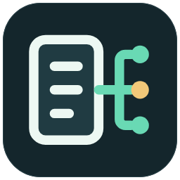
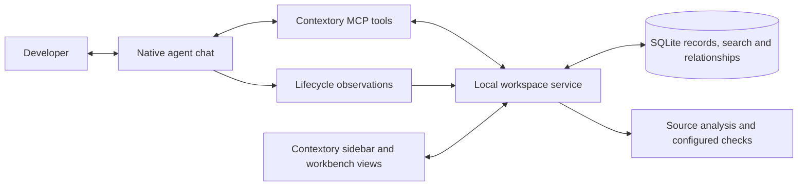
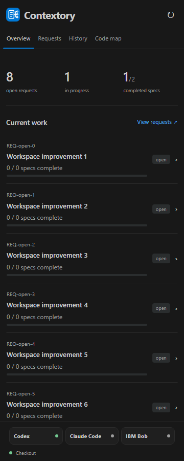

# Contextory

**0.5.1** fixes native-agent connection buttons: clicking a gray indicator retries setup instead of removing an existing configuration. Labels and tooltips explain retry, connect and disconnect. It includes the governed project knowledge, portable migration, documentation export and project-wide version management introduced in 0.5.0. See the [release notes](docs/releases/v0.5.1.md), [project knowledge](docs/PROJECT-KNOWLEDGE.md) and [versions and tags](docs/PROJECT-RELEASES.md).

**Manage requests. Give agents the full picture.**



Contextory is a VS Code and IBM Bob extension that connects your requests, milestones, specifications, code, decisions, and test evidence. Keep working in the native **Codex**, **Claude Code**, or **IBM Bob** chat while Contextory gives the agent durable project context through MCP tools and lifecycle hooks.

Your agent keeps its own conversation, model, authentication, and editing tools. Contextory manages the project records that need to survive the next session or a switch to another agent.

[Download v0.5.1](https://github.com/igormicadei/Contextory/releases/tag/v0.5.1) · [Full documentation](https://igormicadei.github.io/Contextory/) · [User guide](docs/USER-GUIDE.md) · [Agent tools](docs/MCP-TOOLS.md) · [Development](docs/DEVELOPMENT.md)

The **0.5.1** package includes code intelligence and portable execution alongside [automatic agent discovery](docs/releases/v0.2.6.md), Panel layouts and native usage records introduced since 0.2.3.

## What it offers

| Capability            | What you get                                                                                                                                        |
| --------------------- | --------------------------------------------------------------------------------------------------------------------------------------------------- |
| Request management    | Requests broken into milestones and specs, with acceptance criteria, dependencies, progress, immutable revisions, and original user intent.         |
| Durable explanations  | Issues and fixes, design choices and tradeoffs, evidence, and implementation outcomes attached to each spec.                                        |
| Shared agent context  | MCP tools and managed workflow instructions let native agents retrieve and update the same project records.                                         |
| Automatic connections | Detect installed Codex and Claude Code extensions and the IBM Bob editor, prepare every detected bridge at startup, or pause setup from the footer. |
| Codebase intelligence | Persistent TS/JS and Python graph, ranked task context, impact and path queries, and an Architecture workbench with source citations and coverage.  |
| Portable execution    | Shared codebase/workflow skills, generic MCP export, and a standalone CLI/MCP server for clients without hooks or an editor.                        |
| Search                | Local lexical search over project records and indexed source; optional local vector and hybrid retrieval.                                           |
| Relationships         | Explore how requests, specs, decisions, and source files connect, with titles, summaries, directions, and link rationale.                           |
| Code flow             | Bounded Python and TypeScript/JavaScript call and branch diagrams, source navigation, expansion, and SVG/JSON export.                               |
| Verified completion   | Configured checks run independently, with criterion evidence and source fingerprints checked before completion.                                     |
| Request reports       | Export a request's contracts, changes, decisions, findings, evidence, tests, and outcomes, or a completed-work changelog.                           |
| Daily workspace UI    | Adaptive sidebar/Panel layouts, workspace identity, request progress, recent activity, full history, pinned agent controls and live themes.         |

Search, relationships, source tracing, and request/spec management are available to the **agent through MCP**, as well as to the user through the interface. Contextory does not require a separate chat turn to expose them.

Since **0.4.0**, Contextory supports [isolated reference codebases](docs/CODEBASE-INTELLIGENCE.md#analyze-reference-codebases): map other local repositories for migration or implementation guidance alongside the current project. Use **Architecture > Add reference**; agents select each repository explicitly.

## Install

The current release is **0.5.1**, a preview for **Windows with one trusted local project folder**.

1. Install [Node.js](https://nodejs.org/en/download) **24 or newer**. Check `node --version` in a terminal; restart the editor if you just installed Node.
2. Use VS Code **1.96 or newer**, or IBM Bob. The packaged extension has been tested in VS Code **1.145.3** and Bob's VS Code API **1.126.0**.
3. Download [`contextory-workspace-0.5.1.vsix`](https://github.com/igormicadei/Contextory/releases/download/v0.5.1/contextory-workspace-0.5.1.vsix) from the release assets.
4. In the editor's Extensions view, open the **…** menu, choose **Install from VSIX…**, and select the file. Reload the editor when prompted.
5. Open a single trusted local project folder and select **Contextory** in the activity bar.

You can also install in VS Code from PowerShell:

```powershell
code --install-extension .\contextory-workspace-0.5.1.vsix
```

Install your chosen native agent separately and sign in through its own interface. Python source tracing additionally needs **Python 3.10+**; it does not require a Python editor extension. Optional semantic search downloads its model/runtime separately. Installing the VSIX does not require npm, Rust, a database server, or a model download.

The release includes a SHA-256 checksum. Installation details, upgrades, and troubleshooting are in the [user guide](docs/USER-GUIDE.md).

## Connect an agent and start work

1. Open a trusted project folder: Contextory detects installed Codex and Claude Code extensions and recognizes IBM Bob, then prepares every detected agent's MCP/hooks before its view or an agent session needs to open. For manual setup, click the agent's footer control or run **Contextory: Connect Native …**.
2. Review the generated project MCP/hook configuration. Approve it through the native client's own trust flow, then reload its MCP configuration or restart its session as needed.
3. Configure your project's check recipes in workspace settings so the agent can verify tracked specs. The [user guide](docs/USER-GUIDE.md#configure-checks) has examples.
4. Continue in your native agent's chat. For example:

   > Use Contextory to track this request: add retry handling to checkout. Look up earlier payment decisions, split the request into milestones and specs, inspect the affected call flow, and record the changes, decisions, and test evidence. Complete each spec after verification.

The managed `contextory-workflow` skill and MCP instructions describe the workflow. The agent reads context, registers its session, claims a spec, records explanations, runs checks, submits an outcome, and explicitly requests verified completion. Completing every spec rolls up the milestone and request status. Version 0.3.0 also installs `contextory-codebase`: it explains scoped source retrieval, relationship tracing, earlier decisions, freshness and capability fallback. Both skills share the same content across supported agents, with generic MCP export for other clients; hooks are optional.

A green agent light means configured MCP traffic has been observed. Grey means unconfigured or awaiting traffic; hover for detail. Clicking a configured agent disconnects its owned configuration. The light is not a model sign-in indicator.

Starting with **0.2.6**, `contextory.startupAgent` defaults to `auto`, preparing all detected supported agents. Pause automatic setup with the footer's **Auto-connect** switch or `contextory.autoConnect`; existing connections and records stay available. Fixed providers, `last-used`, and `none` remain optional startup modes. A manual disconnect stays disabled in that workspace until reconnected. Native clients own trust and MCP reload, so first-time setup in an already-running session can still need native approval or an extension/session restart. See [startup settings](docs/USER-GUIDE.md#prepare-the-connection-at-startup).

## How it works



The extension hosts the UI and editor integration. An isolated Node.js service stores request history and handles tools. Heavier source analysis runs outside the extension host; Python source is parsed without importing or executing workspace modules. The relationship graph and optional vectors live alongside the records in SQLite, so there is no separate graph or vector database to run.

Hooks provide bounded context reminders and lifecycle metadata. They do not intercept every native action or guarantee that a model follows a workflow. The developer keeps control of native tool permissions. Contextory stores concise explanations and evidence rather than a mirror of native chat history.

See the [architecture](docs/NATIVE-AGENT-ARCHITECTURE.md) for process boundaries, data invariants, retrieval, analysis limits, and transport details.

## Explore the interface

- **Overview:** every open request with spec progress, the three latest activities, and pinned native-agent controls.
- **Requests:** one card per request; expand milestones and specs inline, inspect contracts/issues/decisions/evidence/outcomes, search previous work, export reports, or explore relationships.
- **History:** full paginated history with links back to the owning request, milestone, and spec.
- **Architecture:** subsystem dependencies, entry points, symbol/task search, linked project decisions, source navigation, and index freshness and coverage.
- **Code map:** trace from the last source cursor with a default of five call hops. The editor context-menu command **Contextory: Trace Flow from Here** opens a separate workbench view.

All views follow live VS Code theme changes, including custom and high-contrast themes, without resetting drafts or navigation.

The header shows the workspace name on every tab. Move **Workspace Tasks** to VS Code's **Panel** for a horizontal layout: current work and activity share columns, and the request list sits beside a spec inspector. The view adapts to its available width and height while preserving selection and drafts. The [user guide](docs/USER-GUIDE.md#use-the-sidebar-and-workbench) explains docking and scrolling.

[Architecture explorer](artifacts/architecture-explorer.png) · [Code map explorer](artifacts/code-map-explorer.png) · [Theme previews](artifacts/themes.png) · [Request details](artifacts/request-details.png) · [Relationships](artifacts/relationships.png) · [Source flow](artifacts/source-flow.png)

<details>
<summary>See the sidebar</summary>



</details>

## Storage and current scope

Native model and usage records include a specification **Usage** tab, request-report summaries and the agent-facing `contextory_usage_get` tool. Codex can supply per-request token counts; Claude supplies model metadata; Bob's documented hooks currently supply neither. Capture stays local and does not read chat transcripts. Missing counts remain unavailable. See [provider coverage and task association](docs/USER-GUIDE.md#agent-models-and-usage-024).

Records, immutable revisions, audit events, artifacts, and service credentials live under the extension's editor-managed global storage, separated by canonical project path. Native MCP/hook configuration and workflow skills are written into the project. The [user guide](docs/USER-GUIDE.md#configuration-and-storage) lists the files and explains backup and disconnect behavior.

Standalone CLI/MCP uses a separate ledger in `<root>/.contextory-local/service` unless an explicit storage directory or live editor descriptor is supplied. Back up that directory when using headless mode. The source graph is rebuildable; the additive schema 4 migration preserves authoritative work records.

This is a local preview. Remote WSL/SSH/container workspaces, multi-root projects, other operating systems, large-monorepo performance, and universal language flow extraction are not qualified. Authenticated conversations in all three native agent extensions remain a separate qualification step; automated checks cover MCP workflows, hooks, configuration, and actual editor hosts. Static diagrams show possible bounded paths and expose unresolved dynamic behavior.

Version 0.2.3 uses the Contextory extension identity and tool/settings namespace. Disconnect a build installed under the previous name before replacing it. Its records remain in the former extension storage and are not imported automatically.

## Documentation

| Document                                               | Contents                                                                                                                |
| ------------------------------------------------------ | ----------------------------------------------------------------------------------------------------------------------- |
| [User guide](docs/USER-GUIDE.md)                       | Prerequisites, installation, first use, workflows, settings, search, code maps, reports, upgrades, and troubleshooting. |
| [Codebase intelligence](docs/CODEBASE-INTELLIGENCE.md) | Source coverage, Architecture, Graphify, portable skills, generic MCP and headless CLI.                                 |
| [Release notes](docs/releases/v0.5.1.md)               | Version 0.5.1 changes, installation, upgrades and qualification.                                                        |
| [MCP tools](docs/MCP-TOOLS.md)                         | Available agent tools, examples, version/lease rules, and the completion sequence.                                      |
| [Architecture](docs/NATIVE-AGENT-ARCHITECTURE.md)      | Runtime components, storage, boundaries, retrieval, source analysis, and resource limits.                               |
| [Development](docs/DEVELOPMENT.md)                     | Build, tests, debugging, packaging, and the release process.                                                            |
| [Validation](docs/VALIDATION.md)                       | Test coverage, packaged editor-host checks, benchmarks, and qualification limits.                                       |
| [Spec outcome template](docs/SPEC-OUTCOME-TEMPLATE.md) | Guidance for useful findings, decisions, evidence, and report explanations.                                             |
| [Delivery record](docs/NATIVE-AGENT-PLAN.md)           | Architectural choices and the implementation history.                                                                   |
| [Changelog](CHANGELOG.md)                              | Changes included in each version.                                                                                       |

## License

The project is currently marked **UNLICENSED**; no open-source license has been granted. Bundled dependency licenses are listed in [THIRD_PARTY_NOTICES.txt](THIRD_PARTY_NOTICES.txt).

### Governed application knowledge

The current development build includes a **Knowledge** view for file responsibilities, rules/features linked to tests, and UI layout/interaction contracts. Review concrete before/after proposals while retaining every definition revision and approval reason. Use the portable `contextory-migrate` agent to bootstrap an existing project, and `contextory_project_export` to let native agents generate documentation from all stored application datasets. See [governed knowledge and documentation](docs/PROJECT-KNOWLEDGE.md) for usage and coverage limits.

The development build also includes global **Versions**: automatic Git observation, version bumps, exact commit changelogs, reviewed release commits/tags and separately verified publication to GitHub or another Git remote. The same controller works from UI, CLI/CI and MCP without relying on agent memory. See [project versions and tags](docs/PROJECT-RELEASES.md).
