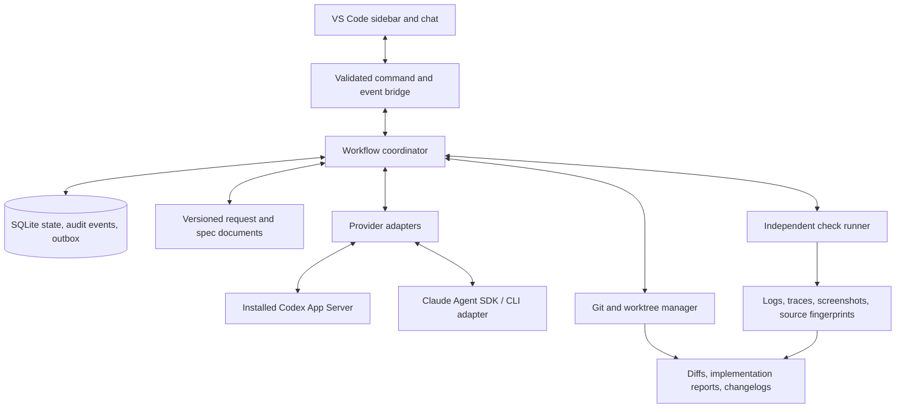

# Relay architecture and durable contracts

> Update: the first experimental live engine is now implemented. [IMPLEMENTATION.md](IMPLEMENTATION.md) describes its actual scope and limitations; preview-only statements below refer to demo mode or the earlier design baseline. [VALIDATION.md](VALIDATION.md) records current evidence.

Status: proposed production architecture. The current implementation contains the sidebar prototype, mock state transitions/routing, local attachments and metadata reference discovery, executable version checks, and a read-only Codex discovery probe. Reviewed against official provider documentation on 2026-11-10; runtime versions and capabilities must be checked during implementation. [CONVERSATION.md](CONVERSATION.md) extends this architecture with detailed conversation, intake-tool, decision, model/effort, and context contracts.

## Product boundary

Relay owns requests, revisions, planning documents, scheduling, worktree lifecycle, verification, Git provenance, progress, and reports. The selected provider supplies its coding runtime, native customization discovery, permission mechanisms, and session context. Provider assignment is per request. There is no requirement to transfer a session between providers.

The UI subscribes to events; it does not infer completion from assistant prose or elapsed time. Production storage is separate from disposable execution worktrees. The current webview uses workspace/local storage and is not the production database implementation.

## Process layout

1. **VS Code extension host:** registers views/commands, checks Workspace Trust, handles editor/diff integration, and translates validated messages. Run on the workspace host for SSH/WSL/dev containers, not automatically on the UI machine.
2. **Coordinator worker:** owns side effects, transactions, provider subprocesses, and verification processes. Initially follows the VS Code lifecycle. A later separately managed worker supports explicitly enabled execution after VS Code exits; never imply that the extension host can survive closing VS Code.
3. **Webview:** presentation and input only. Restrictive CSP, local assets, text escaping, validated IDs, no direct shell/filesystem/provider credential access.
4. **Provider subprocesses:** preserve native user home, config directory, environment, trust, and managed policy. Execute from the prepared worktree. Windows and WSL are distinct environments.

Select the SQLite driver/worker runtime in a packaging spike: Electron ABI compatibility, Windows installation, remote hosts, locking, and crash recovery decide the choice. Do not accidentally depend on the developer's Node version inside the extension host.

## Persistent model

All entities have stable IDs, creation timestamps, schema versions, and revision numbers where mutable. Use opaque internal IDs and readable display IDs. Display IDs alone are not globally unique.

| Entity | Required fields and purpose |
| --- | --- |
| Project | Stable project ID, repository-instance ID, Git common directory identity, workspace roots, execution host identity, base/remote policy |
| Conversation / Message / ChatTurn | Project-scoped transcript, immutable role/text/context, request links, provider/native session and turn correlation, question/discussion/change/unclear intent, requested/effective settings, delivery/retry state |
| Request | Original immutable user text, provider, current revision, normalized intent, status, dependencies, priority |
| RequestRevision | Previous revision, changed requirements, reason, originating user message, affected nodes |
| IncomingMessage / IntakeOperation | Immutable text and typed context/settings; create/amend/reopen intent, target revisions, rationale, idempotency/correlation ID and affected nodes |
| Decision / Response | Request/spec revision, execution generation, question/options/custom-answer policy, blocking scope, native correlation, answer/obsolete state |
| ExecutionSettings / CapabilitySnapshot | Requested and effective agent/model/effort; provider/runtime/account/cwd capability catalog and supported modalities |
| Attachment / ContextReference | Host-owned bounded content handle/hash/retention or workspace/native identity; provider/scope/kind/resolution provenance |
| Milestone | Request, versioned contract, dependencies, integration target, base/head refs, completion policy |
| Spec | Milestone, versioned contract, acceptance criteria, affected paths, dependencies, required capabilities, check recipe IDs |
| Session | Provider/version, native session ID, request, execution worktree, permission profile, discovery snapshot, lifecycle |
| Execution | Spec revision, session, source baseline, current phase, attempt budget, cancellation generation, ownership lease |
| VerificationRun | Recipe/version, argv/cwd/environment-reference, exit result, source/contract fingerprint, artifact IDs, provenance |
| Commit | Repository instance, full object ID, parents, observed branch, subject, reachable refs, origin type |
| SpecCommit | Spec/revision, commit, role (implementation/fix/revert), verification-run links; many-to-many |
| Integration | Input commits, resulting commits, target/base/head, rewrite mapping and confidence, reconciliation state |
| Event | Sequence, unique event ID, aggregate/version, actor/source, timestamp, correlation/causation IDs, validated payload |
| OutboxIntent | Idempotency key, action, parameters reference, expected preconditions, observed outcome |
| Artifact | Content hash, type, relative storage key, size, retention class; no credentials in paths/metadata |

Store current-state projections and audit events transactionally. Full event sourcing is optional; an append-only audit with replayable projections is sufficient. Side-effect intents and results support reconciliation after crashes. Never label an external side effect exactly-once merely because the database transaction is atomic.

Versioned documents live under a configurable tracked folder, initially `.relay/requests/<request-id>/`, with request.md, decisions.md, milestones, and specs. Ephemeral state, raw logs, credentials, and SQLite do not go into that folder. Document and database revisions reference the same contract hash. Imported changes produce revisions rather than silently overriding history.

## Status rules

Request: `received → investigating → needs-input | planning → ready → running → blocked | completed | cancelled`.

Pause, stop/interruption and reconciling states are explicit execution-control conditions, distinct from technical blockers and pending user decisions. The collapsed request projection carries text plus a status indicator. Amendments to completed requests reopen to investigation/planning and retain prior revision/commit history. Requests is the current projection; Activity is its event history.

Spec: `draft → ready → implementing → verifying → committing → pushing → completed`, with `blocked`, `paused`, `cancelled`, and `superseded` transitions defined explicitly. Run phases are separate from durable artifact badges. A spec can have verified source and an unsuccessful push; it remains incomplete under the default push policy.

Parent status derives from eligible children plus parent-level gates. A milestone requires its final suite to pass against the final source and its integration policy to succeed. A request is complete only when all required milestones and request-level gates pass. Cancelled/superseded nodes remain visible in history and are excluded from active progress denominators.

## Progress rules

- Overall = completed active leaf specs / total active planned leaf specs in the current queue scope.
- Current milestone = completed active specs / total active specs in the executing milestone.
- Initially use equally weighted, reasonably sized specs. These are completion ratios, not time estimates.
- Unplanned requests appear separately; a queue with unplanned work must not show unconditional “all work complete.”
- Display current phase without an invented implementation percentage.
- Plan revisions may lower completion; explain the scope/revision change and retain the prior snapshot.
- Separate verified, committed, pushed, and integrated badges. Never count parents as extra work.

## Git default policy

Configure the repository base/remote/integration policy once per workspace; honor explicit user preferences. Proposed default:

1. Create `relay/<request-id>/integration` from the chosen base in an owned worktree, preserving the user's original checkout.
2. Create `relay/<request-id>/<milestone-id>` from the request integration head.
3. For each spec, inspect the diff, stage only owned changes, run required checks, create one or more associated commits, and push the milestone branch when a remote is configured and pushing is enabled.
4. Run the complete milestone gate against the final source. Advance the request integration branch, normally by fast-forward. If its head changed, reconcile and reverify rather than force-update it.
5. Start the next milestone from the updated request integration head. Independent requests use separate worktrees; dependencies explicitly select which integrated head they require.
6. Integration into the user's main branch and publishing/releases follow separately configured policy. A pushed request branch is labeled as awaiting integration when appropriate.

No automatic force-push, destructive checkout, hard reset, credential changes, or deletion of dirty worktrees. A worktree is eligible for cleanup only after ownership/path/dirty-state/ref checks. Git worktrees isolate files; they do not isolate database services, ports, credentials, or writable MCP state.

Dirty original files are not implicitly copied into a new worktree. Investigation records the baseline; an explicit snapshot policy is required if the request depends on uncommitted user changes. Ignored local setup is copied or recreated through an explicit worktree setup manifest. Do not copy an entire home/config directory.

## Evidence and completion

The check runner records commands and exit codes independently of model assertions. A verification fingerprint includes relevant tracked/untracked source content, check recipe version, spec contract version, runtime/config identity needed for reproducibility, and environment/test-data identifiers. Avoid embedding secret values. Bind evidence to tree content so creating a commit does not invalidate checks just by changing HEAD; hooks that change content do invalidate affected checks.

Record pre-existing failures separately. Never turn a failing required check into an optional one to make the milestone green. A justified exemption is an explicit revision with a reason and affected acceptance criteria. Browser visual-baseline changes are reviewable artifacts, not automatic proof that a regression is acceptable.

Recipes declare coverage and invalidation rules. Shared-source changes invalidate dependent checks/spec evidence when applicable. Final milestone verification covers interactions between earlier specs. A revert, source change, contract revision, or newer failing run can invalidate prior success. Imported agent-reported evidence is marked untrusted until reproduced by the runner.

## Incoming changes, scheduling, and recovery

Record every user message before classification. Separate independent new requests from amendments. Present proposed grouping/impact, ask only material questions, and preserve the original wording.

Classify conversation intent before task intake. Questions and brainstorming are supported turns whose queue APIs are read-only; a request ID or discussion of an improvement cannot authorize amendment/reopening. Keep chat turns separate from implementation instructions and correlate them with native sessions. The coordinator enforces allowed mutation scope; clear requested changes proceed without a routine extra confirmation. Persist paginated transcript messages and concise linked acknowledgments/decision/run updates, deduplicated by originating event ID. Keep raw tool noise in Activity. Chat is the default view; Requests is an inspector. Both progress bars share a compact expandable strip; model settings and utilities open on demand. Preserve the reader's scroll position for arriving updates. Full contracts: [CONVERSATION.md](CONVERSATION.md).

The selected runtime uses project-scoped request search/get/intake tools across all statuses, including completed work. UI selection does not determine the target. Create/amend/reopen plans use optimistic revision checks and idempotent transactional application. Typed questions, execution settings, attachments, and native references follow [CONVERSATION.md](CONVERSATION.md). Provider-specific model/reasoning and reference catalogs come from native discovery rather than a shared hardcoded catalog.

Queued specs can be revised transactionally. Changes to active work require a checkpoint or controlled interruption. Bump the execution generation so late provider/process events cannot complete a new revision. Retain prior commits/evidence as history. Recompute dependencies, path leases, checks, and progress.

Initially allow one implementation writer per request/worktree; allow independent requests only after global Git/port/service constraints are enforced. Dependencies are a DAG underneath the tree. Cycles are rejected with an explanation.

Use leases/heartbeats for ownership and ordered event IDs for UI recovery. After restart, inspect actual Git refs, process/session state, pending outbox actions, and evidence before continuing. A database “running” flag never proves a process is still running. Reconnect to saved native sessions when supported; otherwise reconstruct context from versioned documents and explicit checkpoints.

## Provider contract

Each adapter implements `detect`, `inspectCapabilities`, `start`, `send`, `interrupt`, `resume`, `close`, and a normalized event stream. Feature flags are discovered rather than assumed. Events distinguish assistant text, tool lifecycle, approvals, session metadata, usage where available, and terminal results. Keep provider-specific payloads internally without forcing unsupported behavior into the common contract.

Codex: installed `codex app-server`, stdio JSONL initially; native configuration and discovery preserved. Claude: TypeScript Agent SDK with `settingSources: ["user", "project", "local"]`, the `claude_code` preset, native skills/agents retained, no restrictive MCP override. CLI streaming adapter is an alternative tested separately. Never use an empty alternate home or bare/safe mode as the default compatibility solution.

Do not shadow user agents with programmatic names. Keep each provider's native file formats. Classify UI-only capabilities and unsupported runtime features honestly. Mandatory capability failures block setup with actionable diagnostics. Providers maintain separate credentials and sessions.

## Goal Guardian lessons

Reviewed source: `C:\Projetos\CustomAgents\plugins\goal-guardian` and its referenced runtime, migration, workflow, and panel files. Goal Guardian was read, not run or adopted as this project's runtime.

Reuse concepts: immutable original intent; audited amendments; dependencies and scoped ownership; Git reconciliation; source/contract-bound evidence; newer failures overriding older passes; independent verification. Its one-active-goal restriction, agent-reported checks, read-only polling panel, reminder hooks, and human-only closure policy do not meet or define Relay's requirements. Relay's runner must collect evidence itself, and its own workflow policy determines automatic completion.

## Credentials, trust, and distribution

Use provider-owned login flows and VS Code SecretStorage only for extension-owned credentials if needed. Never collect native account token files or expose credentials to the webview. Preserve managed policy and permission prompts; no automatic trust changes. Treat tool output, repository documents, and MCP responses as untrusted input to planning.

Authentication/distribution feasibility is a release gate. A CLI wrapper does not by itself change the provider's permitted authentication model. Validate local/private versus distributed/commercial use against current official documentation before releasing. No production subscription-authentication claim is established by this prototype.
