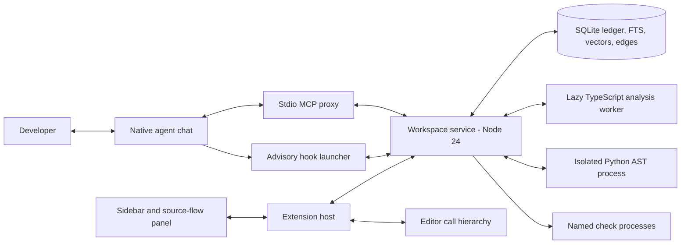

# Native-agent companion architecture

Local 0.3.0 adds a separate rebuildable schema 4 source projection (`code_files`, `code_nodes`, `code_edges`, `code_imports`) to the same SQLite database. A bounded isolated worker resolves TS/JS using the compiler and invokes Python in isolated AST-only mode. Content/configuration/import hashes drive serialized publication and stale-edge removal; debounced filesystem/Git events and a poll schedule refresh. Imported Graphify facts retain provenance and are withheld after cited sources change. Authoritative work records and evidence remain independent of generated topology.

`CodeQueries` combines definitions, bounded source neighborhoods and explicitly linked records for task context, source impact, paths and architecture. The brief reads cached orientation metadata. Canonical skill resources are generated into a shared runtime bundle; a capability registry owns client discovery/configuration/hook differences, including a hook-free generic adapter. `dist/contextory.mjs` uses the same service and MCP contracts with an EOF/signal-owned headless lifecycle. See [coverage, storage and transport details](CODEBASE-INTELLIGENCE.md).

`src/agents/instructions.ts` supplies the same retrieval/workflow guidance to both MCP initialization paths and the workspace brief, plus compact reminders for session/prompt/post-compaction hooks. Instructions route tasks through current-source context, relationships and prior decisions, preserve coverage/provenance and explain saved-file freshness and missing-capability fallback. Canonical skills provide progressively loaded input/recovery details. Skill-only workspace synchronization reuses registration's ownership-aware atomic file handling without changing client MCP/hooks. Host-specific differences remain in adapters.

Current local version 0.3.0, 2026-11-16. [User guide](USER-GUIDE.md) · [Agent tools](MCP-TOOLS.md) · [Delivery record](CODEBASE-INTELLIGENCE-PLAN.md) · [Validation](VALIDATION.md).

## Responsibility boundary

Model and usage records are observations from native hooks, not a model proxy. Ledger schema 3 adds an indexed `agent_usage` projection with provider/session/turn/agent identity, model, optional token fields, status, timestamp and optional spec reference. Migration from schema 2 is additive. Capture is transactional and idempotent per observation; the launcher generates an invocation ID when the native payload has no request ID so identical attempts are not collapsed. Only exact native-session matches with one live spec lease are attributed. Missing or ambiguous observations remain available at project level. Queries aggregate in SQLite and page metadata records; ordinary observation responses do not rebuild the workspace brief. Source chat content and transcript files are never read by this path. See [provider coverage and limitations](USER-GUIDE.md#agent-models-and-usage-024).

The developer stays in the native agent UI. Codex, Claude Code or IBM Bob owns message processing, models, credentials, history, compaction, editing and native tool permissions. Contextory owns shared project records, independent configured checks, retrieval and navigation. No Contextory turn needs to be opened before a native agent can call MCP.

Routing through Contextory means routing supported lifecycle observations and project operations through its local service. Hooks cannot intercept every native action, guarantee that a model uses a tool, or reconstruct missing explanations. Contextory neither proxies model traffic nor runs a second chat.

## Process and deployment choices

The extension host contains UI, provider registration, source navigation and public editor API calls. A separate Node 24+ service uses built-in `node:sqlite`; no compiled SQLite add-on or Cargo build is required. A worker thread loads the TypeScript compiler only for source analysis. The service can outlive an individual client briefly, accepts additional editor clients and stops after its editor heartbeat grace period expires.

Early activation prepares the local service before any native session is required. `vscode.extensions.all` supplies enabled extension IDs and `vscode.env.appName` identifies the editor host. Exact, case-insensitive IDs recognize Codex, Claude Code and Bob; the Bob host also selects its built-in agent. `contextory.startupAgent` defaults to `auto`, preparing every detected provider, while fixed-provider, last-used and no-selection modes remain available. The extension-change event rescans without activating native extensions or polling the extension registry.

`contextory.autoConnect` pauses automatic setup and managed configuration refreshes without removing existing connections or stopping the service. Provider writes are serialized with manual actions and errors are isolated per provider. Manual connections and observed MCP/hook timestamps update editor mementos; explicit workspace disconnects suppress re-registration until a manual reconnect. Native client trust, reload and session startup remain client-owned. No public Codex/Claude editor command allows Contextory to force MCP reload; an already-running native client may need approval or an extension/session restart after first-time configuration.

The movable webview uses a geometry breakpoint (at least 760 pixels wide and a 3:2 aspect ratio) for a horizontal Panel layout. Match-media changes trigger rendering only at layout transitions; navigation, drafts and independently scrolling regions retain their state. Narrow views keep inline spec expansion, while horizontal Requests uses one request list and one selected-spec inspector. All surfaces receive the workspace name from the editor before the service responds and use live VS Code theme tokens.

TypeScript remains the engine language. The recorded 100-file/2,200-function fixture is fast enough for this slice, so an additional Rust binary/distribution protocol was not introduced. That measurement is not a large-monorepo qualification. The renderer uses a bounded SVG layout and no graph-layout dependency.

The optional embedding runtime is prepared outside the VSIX: `@huggingface/transformers` 4.3.2, q8 CPU `Xenova/all-MiniLM-L6-v2`, revision `751bff37182d3f1213fa05d7196b954e230abad9`, 384 dimensions. Model queries disable remote fetching. Preparation is explicit and retains third-party notices. The service remains usable without this runtime.

## Records and invariants

SQLite WAL stores entities, immutable revisions, audit events, operation results, project relationships, check jobs, normalized hook metadata, FTS chunks and vectors. A project ID and canonical root bind each ledger. There is no importer for the old chat/router data model.

The hierarchy is request → milestone → spec. Findings, decisions, evidence and outcomes belong to specs. Sessions correlate native work; they do not store native chat. Requests retain their original intent and append amendments. Historical revisions can be retrieved with `contextory_entity_get` and `revision`.

Mutations validate schemas, use idempotency keys and require revisions where records are edited. An active 30-minute implementation lease belongs to a provider/session; renewal and expiry are checked. Declared dependencies are part of the spec contract and must stay acyclic. Generic relationships cannot silently change dependency readiness.

The normal spec path is ready → implementing → submitted → completed. Block, cancel, revise and reopen preserve history. Claiming another attempt increments its generation. Revised contracts invalidate prior completion eligibility.

`contextory_outcome_submit` returns the current spec revision and an explicit next action: `contextory_spec_change` with `action=complete`. The MCP bootstrap, tool descriptions, workspace brief and managed provider skills all describe this final call. Completion rolls up milestone/request state; reopening or adding planned work reopens the affected parents. An empty milestone remains open. Missing check recipes are a configuration task for native editing, rather than a reason to silently abandon an open spec.

Audit reads use stable sequence cursors, an indexed descendant scope and `contextory_history_get`; the full History tab is not capped by Overview's three recent events. Titles describe operations using stored record titles, and hierarchy breadcrumbs link back to inline request details. Reports require a request ID through MCP and include its descendant records, original/amended contracts, acceptance criteria, outcome history, findings, decisions, check recipes, output, provenance and snapshots. Unrelated requests are excluded.

An outcome maps each criterion exactly once to evidence and preserves summaries of issues/fixes, choices, validation, limitations and changelog text. Completion requires matching source/contract/attempt, passing independently run evidence, no later failed run of the same recipe, no current pending checks, resolved blocking findings and completed dependencies. Agent-authored claims remain reported evidence. A Stop hook never completes a spec.

Check recipes come from trusted workspace settings. The runner accepts recipe IDs, uses argv without a shell, fingerprints disk before/after, bounds time/output, stores artifacts and supports cancellation. Source hashes include tracked, dirty and untracked content plus HEAD identity. It never stages, commits or pushes. Restart marks running jobs interrupted.

## Transport and native adapters

The service listens only on an ephemeral `127.0.0.1` port. Private descriptors contain separate rotating tokens for editor, each provider and each provider's hooks. Browser-origin requests are refused. Hook credentials can only ingest metadata; native MCP credentials cannot configure checks or impersonate editor actions.

Managed stdio proxies use the official MCP SDK and reread the descriptor on every call. Existing native connections survive service descriptor rotation. Initialization and tool discovery do not depend on service readiness: the proxy embeds the canonical tool catalog generated from the schemas at build time. A read-only `tools/list` RPC retries with bounded backoff for at most 15 seconds; tool execution waits for readiness, then sends its request once. Mutations are never automatically replayed. Native stdin closure cancels pending waits, and a failed readiness attempt permits a later retry. Large native results return `ART-` handles; `contextory_entity_get` reads bounded 400-character pages. Flow graphs also support paged node reads and snapshot-checked expansion.

Provider registration preflights every file, preserves comments/unrelated entries, refuses symlink/junction ancestors and rolls back its own unchanged writes after a later failure. Global provider files and permission policies are not changed. Native clients remain responsible for trust/reload. Hook commands use bounded stdin, a 450 ms RPC deadline and advisory failure behavior. Only event/session/cwd/tool metadata is retained; raw prompts, outputs and transcript paths are discarded.

Bob uses plain session/prompt context output; Codex and Claude use their documented structured context output. Bob Stop cannot block continuation, and Bob PostToolUse observes successful calls only. Status distinguishes generated configuration from independently observed MCP/hook traffic. See the qualification boundary in [validation](VALIDATION.md).

## Knowledge and source flow

Records index as bounded text chunks. Explicit source indexing respects Git's tracked/untracked exclusions, skips vendor/internal folders and likely credential locations, and caps files/chunks. Source results are checked against current file content; stale chunks are omitted with a refresh notice. Entity search cites the current record revision; historical versions use explicit detail reads.

Vectors are rebuildable projections bound to content and model identity. At most 10,000 vectors participate in an exact local cosine/dot-product scan. Hybrid retrieval uses reciprocal-rank fusion with FTS. Missing models produce an explicit lexical fallback; semantic-only queries fail explicitly. Vector indexing is an explicit refresh action, not a hook or save side effect. This is a bounded local memory implementation, not a universal code embedding model or exhaustive impact detector.

The project graph uses SQLite edges and reverse indexes. It links hierarchy, declared dependencies, superseded decisions and explicit record/source associations. Traversal has depth/size limits and handles cycles. A separate graph database would add deployment/synchronization cost without a measured need in this release.

Impact results include a selected-record summary and bounded related-record projections: kind, title, ID, status/revision, short description and source references. Edges are deduplicated and reference returned records only. The UI explicitly requests both directions and presents these in a dedicated Relationships workbench panel, with natural-language edge labels and rationale. Selecting a record returns to the owning request/spec and appropriate explanation tab; source links use the existing validated file-navigation path. Panel readiness replays the current relationship data and stays separate from source-flow events.

The sidebar uses a fixed-height flex layout: header/navigation and footer stay visible while the main content scrolls. Agent names and status lights appear only in compact footer controls, with connection detail available through accessible labels/tooltips. Overview has no introductory heading; request progress uses native progress elements with completed/total spec counts. Renders preserve the content scroll position during updates and history pagination.

Code graphs are computed on demand, with the latest 20 graphs cached by snapshot. Calls mode first asks the public editor call-hierarchy commands; TS/JS can fall back to compiler-based resolution. Flow mode derives a supported control-flow subset from the TypeScript AST: conditions, short circuiting, loops, switch dispatch, early return/throw, calls/continuations and conservative try/catch/finally paths. Shared callee bodies do not invent return edges into other callers.

Python calls, incoming calls and flow use an isolated Python 3.10+ standard-library AST process, launched with `-I` and a packaged parser. The service supplies validated source text and editor overlays through stdin, with no workspace imports or execution. It resolves local/nested functions, ordinary workspace imports/aliases and direct instance methods, and maps conditions, match cases, loops, early exits, calls and conservative exception/finally paths. Depth frontiers carry a callee root so expansion advances into the target. Dynamic dispatch, decorators, context-manager behavior, generator suspension and expression-level short-circuit paths remain explicit limitations. Incoming results identify their workspace-only scope.

Python scanning is bounded to 500 files, 512 KiB per source and 12 MiB total, with explicit partial results when limits are reached. Its subprocess has a deadline, output cap, queue bound and cancellation; virtual environments and bytecode caches are excluded. The process exits after each query. The measured fixture supports this deployment without requiring Rust or a third-party parser runtime.

The sidebar and editor flow panel have distinct surfaces. The editor panel starts in flow view and replays the latest graph on readiness; sidebar tracing never creates a panel. The host remembers the last workspace source position, and opens an editor flow panel only after a successful trace. Service/UI versions are checked during attachment to avoid using stale analysis code after upgrades.

Root is hop zero. Defaults: five call hops, 150 nodes, 300 edges, ten editor callee targets per expanded function, two seconds of interactive work. The TS resolver currently supplies one statically resolved target per call; dynamic alternatives are an explicit analysis gap. Service caps are 12 hops, 500 nodes, 1,000 edges and ten seconds. The worker has a memory cap, bounded request queue, cancellation/restart and a deadline including startup allowance. Late editor results are discarded.

Unsaved overlays are accepted only from the trusted editor connection and included in snapshot hashes. Document changes invalidate expansion handles. Disk changes are rechecked before expansion. Source links are validated against the real workspace root. SVG/JSON exports retain the bounded graph; reports remain independent of native transcripts.

## Current limits

This preview qualifies one local Windows folder with Node 24+ and Python 3.10+ for Python analysis. Native model/extension conversations, remote path mappings, multi-root selection, large-monorepo resource budgets and further language branch extractors need separate qualification. Overview includes all open requests; full audit history is cursor-paged. UI request filtering uses cached record/parent indexes and includes descendant explanations. Optional model cold loading is separate from interactive lexical/flow performance.

Authoritative API schemas: `src/contracts/tools.ts`. Implementation: `src/core`, `src/service`, `src/storage`, `src/knowledge`, `src/analysis`, `src/editor`, `src/providers`. No runtime dependency exists on `C:\Projetos\CustomAgents`; Goal Guardian informed the workflow invariants, and its code is not bundled.

## Protocol references

- [Codex hooks](https://learn.chatgpt.com/docs/hooks) and [MCP](https://learn.chatgpt.com/docs/extend/mcp)
- [Claude Code hooks](https://code.claude.com/docs/en/hooks) and [MCP](https://code.claude.com/docs/en/mcp)
- [Bob lifecycle hooks](https://bob.ibm.com/docs/ide/configuration/lifecycle-hooks) and [MCP](https://bob.ibm.com/docs/ide/configuration/mcp/mcp-in-bob)
- [VS Code public commands](https://code.visualstudio.com/api/references/commands), [Node SQLite](https://nodejs.org/api/sqlite.html)
