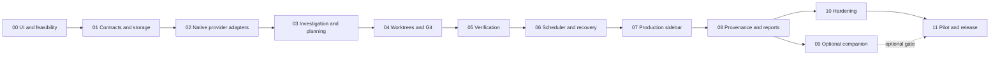

# Relay: full implementation plan

> Update: the first experimental live engine is now implemented. [IMPLEMENTATION.md](IMPLEMENTATION.md) describes its actual scope and limitations; preview-only statements below refer to demo mode or the earlier design baseline. [VALIDATION.md](VALIDATION.md) records current evidence.

Version 6 · 2026-11-11 · Provisional product name: Relay

## Deliverable and current scope

Build a VS Code extension that turns conversation into a durable queue of **requests → milestones → specifications**, investigates the codebase, clarifies material questions, executes eligible work with Codex or Claude Code, verifies it, records commits/pushes, and produces useful diffs/reports/changelogs. Preserve each provider's global and project agents, skills, instructions, hooks, and MCP configuration where the native runtime supports them.

**This delivery adds an experimental vertical slice across M01-M08: live providers, durable snapshots, validated planning, worktrees, independent checks and Git provenance. It does not complete all production milestones. See IMPLEMENTATION.md for exact limits.** Later milestones below are a development backlog, not claims of completed functionality. The UI's fictional application tasks are demo fixtures, separate from this extension's development backlog.

Claude now defaults to the M09 native-extension companion slice: a documented prefill URI and additive local MCP bridge share the same task queue. Send, model/effort, permissions and native chat remain in Claude. The SDK adapter remains optional and recognizes settings-based custom-gateway auth. Both existing provider settings use the IBM endpoint; no authentication replacement is needed. See COMPATIBILITY.md for the worktree/lifecycle limits and unverified end-to-end steps.

Relay 0.1.2 also adds **Relay: Connect Native OpenAI Codex** for the M09 companion slice. It appends project-scoped MCP configuration, preserves existing settings and uses public editor commands to attach a Relay turn to native Codex chat. Native submission/model/reasoning/permissions remain there; App Server remains available. Standard MCP/coordinator/Git fixtures validate each provider independently; actual native editor/model handoffs remain an open validation step.

Read [ARCHITECTURE.md](ARCHITECTURE.md) for authoritative invariants and data contracts, [COMPATIBILITY.md](COMPATIBILITY.md) for provider experiments and sources, and [SPEC-TEMPLATE.md](SPEC-TEMPLATE.md) for implementation-ready document structure.

[CONVERSATION.md](CONVERSATION.md) specifies the revised intake tools, decision protocol, native model/effort discovery, attachment/reference contracts, completed-request reopening, and prototype boundaries. It extends the existing specs below; the backlog remains 12 milestones and 37 specifications.

## Requirements and decisions

| ID | Requirement | Implementation milestones |
| --- | --- | --- |
| R01 | Investigate the actual codebase before deciding what to do | M03 |
| R02 | Brief, targeted clarification when material facts are missing | M03, M07 |
| R03 | Split compound requests by sensible development boundaries | M03 |
| R04 | Detailed durable plans that survive a fresh session | M01, M03 |
| R05 | Isolated worktree; new branch per milestone; associated spec commits/pushes | M04, M08 |
| R06 | Meaningful unit/integration/browser verification; final milestone gate | M05 |
| R07 | Automatic continuation with dependencies, bounded repair, and recovery | M06 |
| R08 | Shared sidebar/chat/task tree; live event-driven updates | M00, M07 |
| R09 | Accept new requests and amendments during execution | M03, M06, M07 |
| R10 | Codex and Claude with native global/project customization | M02; optional M09 |
| R11 | Playwright functionality, containment/overflow, and visual regression | M05 |
| R12 | Overall and current milestone progress bars | M00, M07 |
| R13 | Link specs/milestones/requests to commits and open diffs | M04, M08 |
| R14 | Evidence-based reports and changelogs from resulting changes | M08 |
| R15 | Respect native authentication, permissions, trust, and managed policies | M02, M10, M11 |
| R16 | Persistent collapsed request state badges; Requests projection vs Activity history | M00, M01, M07 |
| R17 | Revision-bound option/custom-answer questions; independent native permission approvals | M00, M01, M02, M03, M07 |
| R18 | Provider-derived agent/model/reasoning controls and supported input modalities | M00, M02, M07 |
| R19 | Agent search/get/intake tools; automatic create/amend/reopen across the full queue | M00 simulation; M01, M03, M06, M07 |
| R20 | +/paste file/image attachments; @ files/folders; $ agents/skills; / skills | M00 preview; M01, M02, M07, M10 |
| R21 | Full project conversation; questions/discussion without task mutation; linked intake and execution replies | M00 preview; M01, M02, M03, M07 |
| R22 | Conversation-first sidebar; compact dual progress; settings/history/controls on demand | M00, M07 |

Defaults: provider selected per request; no automatic provider handoff. Overall progress counts completed active leaf specs; current progress follows the executing milestone. One writer per request/worktree initially. Independent request concurrency follows explicit dependency/path/service constraints. Git policy uses a request integration branch and milestone branches; integration into the user's main branch follows configured workspace policy. Required customization failures are visible and block the affected run.

## Implementation protocol for every specification

The specs below are detailed work packages for building Relay. At the start of each, load this plan, the linked architecture, relevant prior output, the actual repository baseline, and native project instructions. Write the resolved implementation spec using the template, including exact paths/commands after investigation. Do not invent codebase facts before inspecting them.

Each spec records inputs, chosen approach, acceptance criteria, checks, source/contract revision, checkpoint, and completion evidence. Use one or more coherent commits per spec with request/milestone/spec trailers; push according to the configured development remote. No remote is currently configured by this prototype, so this delivery creates no branches, commits, or pushes. No-change/check-only outcomes are documented instead of fabricating empty commits.

Every milestone has its own branch, starts from its recorded dependency/integration head, and ends with all required milestone checks green. New failures invalidate applicable earlier evidence. Amendments are audited; acceptance cannot silently drift to match an implementation.

## Delivery sequence

M02's live compatibility experiment is a **go/no-go for the chosen adapters**, not for the entire product: a failed SDK path can select a tested CLI adapter or reduce scope to companion mode. M09 is optional unless provider/distribution constraints require it. A durable background worker beyond VS Code's lifetime is a separately enabled expansion in M10, not a prerequisite for a foreground MVP.

## M00 — Reviewable interface and feasibility prototype

Branch: `relay/ms-00-prototype` (proposed). Dependencies: none. Outcome: usable local sidebar and honest compatibility evidence without implementing an agent engine.

### SPEC-0001 — Extension shell and reusable webview

- **Inputs/context:** empty TypeScript workspace, VS Code WebviewViewProvider API, sidebar width 280–480 px, existing user requirements. Current files: `src/extension.ts`, `src/webview/document.ts`, `scripts/build.mjs`, manifest, launch/tasks configuration.
- **Implementation:** register an activity-bar container and movable webview view; bundle extension and browser code separately; serve only local assets under a restrictive CSP; validate every message; render text as escaped content. Add an F5 development launch and local VSIX build. Keep browser preview assets identical to the webview assets.
- **Acceptance:** extension activates on opening Relay; narrow views remain usable; plan and read-only sample documents open; webview cannot request arbitrary commands/paths. Demo operation works in an untrusted workspace while executable checks are disabled.
- **Verification/output:** typecheck/build/package; inspect host message rejection and escaped input; browser test asset loading with no CSP errors. Extension-host activation/security smoke is repeated in M10. Output is a local installable prototype, not a marketplace release.

### SPEC-0002 — Interactive task tree, progress, and revisions

- **Inputs/context:** `src/shared/model.ts`, fixtures, `src/webview/main.ts`, CSS. Use clearly fictional requests assigned to both providers.
- **Implementation:** Chat as the default view with a persistent transcript and separate Requests inspector; compact dual-progress strip with expandable details/controls; model settings and utilities on demand. Retain hierarchy/status badges, spec/check/commit details, filters, per-request controls, decisions, activity history, sample catalogs and context pickers. Route explicit changes across the queue; questions/discussion produce local replies without queue mutation. Explain create/amend/reopen outcomes and simulated execution in linked chat messages. Persist schema-3 preview state, importing schemas 1/2 without losing revisions/evidence/commits/submissions. No manual New/Append toggle.
- **Acceptance:** advancing cannot continue while paused or on a request waiting for decisions; completion progresses through verification/commit/push phases; explicit-spec amendments stale earlier checks; request-level amendments wait for planning; unplanned/reopened scope is explicitly pending; long text/decisions/context chips fit narrow containers. Native file picker/workspace listing and metadata-only skill/agent discovery are clearly separated from browser samples and unimplemented runtime catalogs. All execution evidence remains labeled simulated.
- **Verification/output:** domain transition tests plus real browser interactions, reload persistence, empty search, invalid saved data, long text, keyboard submission, dark/light/high-contrast, and compact heights. No actual repository mutations or model calls.

### SPEC-0003 — Limited native runtime inspection

- **Inputs/context:** installed native executables and official App Server docs. Current files: `src/diagnostics.ts`, `scripts/probe.mjs`, `scripts/probe-lib.mjs`.
- **Implementation:** fixed-argument, bounded, shell-free version checks. Optional explicit Codex App Server handshake followed by configuration and skills discovery; optional MCP status request. Preserve the real native environment. Reports whitelist safe metadata and never print raw configuration, credentials, or stderr. Stop the owned process tree.
- **Acceptance:** missing binaries, malformed responses, timeouts, and partial failures produce actionable bounded results; executable detection never claims authentication/customization execution. No thread/model call, skill invocation, Goal Guardian use, Git mutation, or automatic MCP invocation.
- **Verification/output:** fake protocol server tests and an actual installed-runtime report. Document exactly what was tested. Claude discovery/invocation, real worktree execution, resume, and authenticated turns remain unverified until SPEC-0204.

### SPEC-0004 — Full plan and review artifacts

- **Inputs/context:** this discussion and the completed read-only Goal Guardian review.
- **Implementation:** write this backlog, architecture/data contracts, compatibility matrix/live experiment, standalone spec template, prototype guide, and startup commands. Capture sidebar and full-preview screenshots after functional/containment checks.
- **Acceptance:** a fresh developer can run/review the prototype and identify every deferred capability. The plan covers each R01–R22 requirement with concrete implementation and validation. Screenshots reflect the actual rendered assets.
- **Verification/output:** follow README commands; inspect links, VSIX contents, report labeling, screenshots, and open limitations. Deliver file paths and review instructions.

**Milestone gate:** prototype checks green; local package built; actual browser render inspected; provider evidence explicitly separated from untested claims.

## M01 — Durable domain, documents, and storage

Branch: `relay/ms-01-durable-state`. Dependencies: M00.

### SPEC-0101 — Versioned contracts and transition rules

- **Inputs/context:** architecture entity/status tables, prototype reducers, template. Proposed modules: `src/core/domain/`, `src/core/contracts/`.
- **Implementation:** define runtime-validated conversation/message/turn/intent and request/milestone/spec/revision/dependency/session/execution/evidence/Git contracts. Distinguish a conversation turn from a coding execution; queue mutation requires an authorized change intent. Separate execution phases and artifact states. Encode legal transitions, parent gates, cancellation/supersession, required Git policy, unplanned-work handling, and event correlation. Reject dependency cycles and incompatible revision references. Include paginated transcript storage and native-session correlation per [CONVERSATION.md](CONVERSATION.md).
- **Acceptance:** only current contract/source evidence can satisfy required gates; a required push failure cannot become complete; parent counts never double-count children; a newer failure overrides applicable old success.
- **Verification/output:** table-driven invariant tests and counterexamples: stale result, reordered event, cancelled spec, superseded revision, dependency cycle, and empty/unplanned queue. Publish schema version and transition documentation.

### SPEC-0102 — SQLite storage, events, and side-effect intents

- **Inputs/context:** contracts; extension/worker runtime packaging spike. Proposed modules: `src/core/storage/`, migrations, repository identity service.
- **Implementation:** select a compatible SQLite runtime; transactionally persist aggregates, revision history, ordered audit events, idempotency keys, and outbox intents. Derive repository-instance identity from Git common-dir/workspace host, separate from portable project IDs. Keep DB outside disposable worktrees. Migrate the prototype state only through an explicit importer.
- **Acceptance:** crash between an intent and external outcome can be reconciled; duplicate event delivery is idempotent; schema upgrades are atomic and failed migrations preserve the original; separate clones/remote hosts cannot accidentally share a lease.
- **Verification/output:** actual temporary-database integration tests, forced-process termination at transaction boundaries, migration upgrade/failure tests, simultaneous ownership attempts, and Windows/remote-host driver packaging proof.

### SPEC-0103 — Versioned documents and fresh-session checkpoints

- **Inputs/context:** template and persistent revisions. Proposed `src/core/documents/`, `.relay/requests/` layout, portable export/import format.
- **Implementation:** generate request/decision/milestone/spec Markdown with embedded IDs and contract hashes; reconcile intentional file edits into revisions; maintain an index and minimal restart checkpoint. Store large logs/artifacts separately with content hashes. Define conflict handling for simultaneous UI/file edits.
- **Acceptance:** a session with no prior chat can reconstruct intent, baseline, dependencies, next actions, checks, and prior side effects. Original request wording remains immutable. Conflicts preserve both inputs and require a clear resolution; no hidden overwrite.
- **Verification/output:** round-trip document/database integration tests, conflicting edits, malformed imports, moved workspace paths, and a fresh-session reconstruction exercise against a representative multi-milestone plan.

**Milestone gate:** migrations and restart recovery green; contracts and documents agree on revisions; ownership/idempotency demonstrated with actual storage.

## M02 — Provider adapters and native compatibility

Branch: `relay/ms-02-providers`. Dependencies: M01; sources and experiment in COMPATIBILITY.md.

### SPEC-0201 — Adapter protocol and capability inspection

- **Inputs/context:** normalized provider contract and installed-runtime inspection. Proposed `src/providers/types.ts`, `src/providers/capabilities/`, fixture transcripts.
- **Implementation:** lifecycle API (`detect/inspect/start/send/interrupt/resume/close`), typed normalized event stream, bounded backpressure, request IDs, cancellation generation, and versioned capability snapshots. Include runtime/account model catalogs, per-model reasoning/effort/modalities, native agents/skills/commands with scope and precedence, and typed attachment/reference inputs. Distinguish discovered/enabled/connected/invoked from unavailable/unknown. Keep raw provider payloads away from webview credentials/logs. Apply [conversation contracts](CONVERSATION.md).
- **Acceptance:** UI/coordinator can consume either adapter without assuming feature parity. Unsupported methods have an explicit result; terminal failures, approvals, and user-input requests cannot be mistaken for success.
- **Verification/output:** contract suite using recorded/synthetic protocol streams: malformed/chunked/duplicate events, disconnects, missing capabilities, approval round-trips, and cancellation races.

### SPEC-0202 — Codex App Server adapter

- **Inputs/context:** installed-version protocol schemas and official App Server docs; read-only probe; native config, agents/skills, and MCP setup. Proposed `src/providers/codex/`.
- **Implementation:** own stdio process; initialize using pinned/tested schema; inspect effective config/skills/MCP statuses; paginate `model/list` and discover supported reasoning/modalities; translate typed context into native input; start/resume threads in the prepared worktree; map stream items, correlated questions and approvals; preserve native environment/instructions. Support input/interrupt/usage where exposed. Handle unknown API versions and required managed restrictions without changing trust automatically.
- **Acceptance:** global and trusted project customizations survive; same-name/project precedence follows native behavior; missing required MCP/auth blocks clearly; reconnect uses saved thread ID and documented durable context. Provider prose cannot mark a spec complete.
- **Verification/output:** fake server lifecycle tests and live sandbox tasks, with successful invocation evidence for a harmless skill/agent/MCP; expired auth, timeout, approval rejection, server death, and resume. No claim based solely on CLI detection.

### SPEC-0203 — Claude Agent SDK adapter and CLI contingency

- **Inputs/context:** current TypeScript SDK, native Claude Code configuration, capability contracts. Proposed `src/providers/claude/` and adapter-specific test harness.
- **Implementation:** explicit `settingSources: ["user", "project", "local"]`; `claude_code` preset plus appended workflow context; preserve discovered skills/agents and native MCP configuration; do not shadow native agent names or apply strict/bare overrides. Support streaming input, interrupt, native session ID/resume, permissions, initialization metadata, and partial events. If the tested SDK/distribution path is unsuitable, implement the same contract over unmodified CLI structured streams and document the decision.
- **Acceptance:** user/project/local behavior is evidenced at the correct cwd; native hooks/skills/agents remain available under permissions; project-local MCP paths target the worktree. Separate provider credentials remain provider-owned.
- **Verification/output:** SDK lifecycle/failure contract tests plus live fixture invocations and resume. CLI fallback requires its own equivalent suite; passing SDK tests is not evidence for a CLI adapter.

### SPEC-0204 — Live compatibility go/no-go experiment

- **Inputs/context:** COMPATIBILITY.md experiment; approved authentication setup; throwaway Git repo/worktree; harmless customization fixtures with unique names; existing user customization discovery.
- **Implementation:** for each provider, verify global/project discovery, deterministic project fixture invocation, an MCP read-only echo tool, an agent, interruption/resume, and worktree cwd. Implement one tiny fixture change, run a real assertion, create a local associated commit, and produce a sanitized evidence report. Do not push this fixture or invoke Goal Guardian. Capture filesystem/ref differences before/after.
- **Acceptance:** each mandatory capability has concrete runner/protocol/fixture evidence or a documented failure. Hook execution and any model use are explicit in the test configuration. Retain original user settings. Clearly mark unknowns rather than treating model self-report as proof.
- **Verification/output:** evidence matrix per provider/version/OS; tested SDK versus CLI decision; distribution/authentication assessment; cleanup report for owned fixtures only. If mandatory capability fails, choose fallback and repeat before M03 depends on it.

**Milestone gate:** two tested provider paths preserve required native customization and sessions; unresolved distribution constraints have a concrete supported route or are explicitly release-blocking.

## M03 — Investigation, clarification, decomposition, and planning

Branch: `relay/ms-03-planning`. Dependencies: M01–M02.

### SPEC-0301 — Repository investigation and request intake

- **Inputs/context:** immutable incoming text, workspace roots, current Git baseline, provider capabilities, native instruction sources. Proposed `src/planning/investigate/`, intake service.
- **Implementation:** record text, attachment handles, references, and execution settings before processing; classify question/discussion/change/unclear intent. Answer questions using read-only project/queue context; ordinary mentions of existing work cannot revise/reopen it. For change intents expose bounded project-scoped `requests.search/get/propose_intake/apply_intake` tools per [CONVERSATION.md](CONVERSATION.md), including completed requests and optimistic revision preconditions. Inspect repo structure/build/test tools, relevant implementation/callers, conventions, dirty state, and affected interfaces using the selected runtime. Persist findings with file/source references and uncertainty. In large/monorepos, scope by request and follow dependencies; avoid claiming exhaustive understanding.
- **Acceptance:** investigation identifies actual relevant code and reproducible check entry points; guesses are labeled; original text cannot disappear during normalization. Missing code/tools is visible and does not fabricate a plan.
- **Verification/output:** fixture repositories with misleading filenames, monorepo boundaries, dirty changes, missing tests, and native instructions; review findings against known affected paths and commands.

### SPEC-0302 — Clarifications and engineering decomposition

- **Inputs/context:** investigation, conversation, existing queue, dependency graph. Proposed `src/planning/clarify/`, `src/planning/decompose/`.
- **Implementation:** ask a small set of material questions when answers change behavior/architecture; support options/tradeoffs/recommendation and custom answers with revision/generation/correlation IDs; otherwise record reasonable assumptions. Group requests by behavior/ownership/dependencies, preserve shared constraints, and identify amendments versus new work using search plus retrieved contracts. Reopen completed requests transactionally while preserving prior revisions/commit evidence. Persist proposed grouping and rationale; maintain conversation links without making chat the sole source of truth. Never route solely from UI selection or switch the owning provider silently.
- **Acceptance:** one message may create multiple coherent requests; an amendment updates the intended nodes without duplicating unrelated work; independent work proceeds while an unrelated question waits. The user can correct grouping with audited consequences.
- **Verification/output:** curated multi-intent conversations, ambiguous product decisions, corrections during implementation, cross-cutting changes, and duplicate intent. Measure reviewable accuracy; require schema-valid output plus explicit rationale for splits.

### SPEC-0303 — Detailed milestone/spec generation and review

- **Inputs/context:** resolved request, investigation, template, dependencies, required native capabilities, Git/check policies. Proposed `src/planning/plan/`.
- **Implementation:** generate versioned self-contained specs with concrete approach, affected paths/interfaces, acceptance criteria, migration/error cases, test recipes, dependency outputs, and restart context. Validate required fields, dependency cycles, feasible test commands, scope conflicts, and missing decisions. Expand only ready work when later design depends on evidence; persist assumptions and regenerate affected revisions after findings.
- **Acceptance:** each ready spec can be implemented from its document plus declared inputs; milestone boundaries produce coherent, verifiable increments; unresolvable design ambiguity remains explicit. No new plan silently rewrites a completed contract.
- **Verification/output:** fresh-session implementation/review exercises, invalid-plan rejection tests, contract-hash round trips, dependency/cycle checks, and plan-diff review snapshots.

**Milestone gate:** real fixture request reaches ready state with a code-grounded plan that another fresh session can execute; clarification/decomposition corrections preserve audit history.

## M04 — Worktrees, branches, commits, and pushes

Branch: `relay/ms-04-git`. Dependencies: M01–M03.

### SPEC-0401 — Worktree lifecycle and environment preparation

- **Inputs/context:** Git common-dir identity, request baseline, setup manifest, native customization requirements. Proposed `src/git/worktrees/`, `src/environment/`.
- **Implementation:** create owned request worktrees and milestone branches before starting provider sessions; validate canonical paths, refs, and existing ownership. Prepare dependencies/ignored local config from explicit manifests; preserve user native home. Allocate service ports/test-data namespaces. Verify cwd-bound MCP/hook/script targets; document Windows/WSL distinctions. Track cleanup eligibility and dirty-state protection.
- **Acceptance:** user checkout/dirty files remain intact; two independent worktrees do not share writable service data accidentally; required local config is available or setup blocks. Cleanup cannot target outside owned roots and never deletes dirty/unowned work.
- **Verification/output:** actual temporary Git repositories/worktrees, spaces/Unicode paths, locked branches, missing Git, ignored setup, symbolic path escapes, Windows cases, remote host case, and interrupted setup recovery.

### SPEC-0402 — Per-spec commit/push provenance

- **Inputs/context:** owned changes, current spec/contract, verification fingerprint, Git policy. Proposed `src/git/commits/`, integration outbox.
- **Implementation:** review changed paths against lease, stage owned changes, create associated commits with trailers, record full SHA/parents/tree, reconcile hooks that alter source, and push the configured branch without force. Support multiple corrective commits and exceptional many-to-many mappings. Capture local/pushed states independently. Credentials stay in Git/native helpers.
- **Acceptance:** unrelated/untracked user files cannot be staged; a commit hook mutation invalidates relevant evidence; crash after commit/push recovers by inspecting actual refs rather than repeating blindly. Failed push retains local work and an actionable incomplete state.
- **Verification/output:** real local bare remote, rejected push, missing remote/auth fixture, failing/mutating hooks, staged foreign changes, and termination after each external side effect. Verify trailers and DB mappings against `git log`/refs.

### SPEC-0403 — Milestone/request integration and reconciliation

- **Inputs/context:** complete milestone suite, request integration branch, recorded base/head, dependency graph. Proposed `src/git/integration/`.
- **Implementation:** apply architecture's request/milestone branch policy; advance integration head after gates, reconcile changed targets, record merge/rebase/cherry-pick/squash mappings when performed, and reverify affected source. Detect external rewrites/reverts, retain original associations, and mark uncertain mappings. Start next milestone from the verified dependency result.
- **Acceptance:** later milestones include prior outputs; no hidden assumption that every branch starts at main; ref races never force-update user work. Pushed versus request-integrated versus main-integrated are distinct.
- **Verification/output:** divergent refs, conflicting integration, external rebases/squashes/reverts, deleted branches, and dependent-request scenarios in actual Git repositories. Compare net diffs to recorded ranges.

**Milestone gate:** fixture request produces milestone branches, linked spec commits, successful pushes to a local remote, and correct ancestry with crash reconciliation.

## M05 — Independent verification and browser quality

Branch: `relay/ms-05-verification`. Dependencies: M04.

### SPEC-0501 — Check recipes, independent runner, evidence fingerprints

- **Inputs/context:** plan/check contracts, worktree and spec revision. Proposed `src/verification/runner/`, recipes/artifact store.
- **Implementation:** execute declared argv/cwd/environment references without shell-string interpolation where possible; capture bounded logs, exit codes, timings, source/contract fingerprints, and artifacts. Isolate process trees; support cancellation/timeouts. Record baseline failures, required/optional recipes, applicability, and latest-result invalidation. Model-reported results remain proposals until reproduced.
- **Acceptance:** a green result on older source or contract cannot complete current work; latest relevant failure overrides earlier success; source-preserving commit does not invalidate solely due to SHA change. Failed/timeout/cancelled checks have distinct results.
- **Verification/output:** intentional passing/failing/hanging subprocesses, source mutation during checks, recipe changes, changed untracked inputs, cancellation races, and stale log/artifact rejection.

### SPEC-0502 — Unit/integration coverage and milestone gates

- **Inputs/context:** investigated project tooling, acceptance criteria, current baseline failures. Proposed `src/verification/policy/`.
- **Implementation:** select meaningful unit/integration checks for changed behavior and impacted dependencies; require new/updated coverage where feasible, with explicit justified exclusions. Run focused checks during specs and full required milestone suite on the final source. Track dependent-spec invalidation when shared files change. Bounded repairs create new attempts/commits and preserve failure history.
- **Acceptance:** testing is tied to behavior, not a required number of superficial tests; missing infrastructure is actionable; disabling a failing test or narrowing a gate requires a contract revision. Milestone cannot close with stale or failing required evidence.
- **Verification/output:** deliberately introduce cross-spec regression, baseline-only failure, unavailable tooling, flaky test, and an inappropriate test exemption. Confirm gate behavior and report evidence.

### SPEC-0503 — Playwright functionality and layout assertions

- **Inputs/context:** frontend routes/fixtures, correct worktree dev server, unique port/data namespace, declared supported viewports. Proposed browser recipe adapters and reusable layout helpers.
- **Implementation:** exercise navigation/forms/validation/dialogs/keyboard/loading/error states. Add document and selected-container scroll/bounding-box assertions, unexpected clipping/overlap checks, and deliberate-scroll allowlists. Cover narrow/wide viewports, long localized strings, empty/loading/error datasets. Capture selector/viewport/dimensions/screenshot/trace on failure. Do not hide overflow with CSS to satisfy assertions.
- **Acceptance:** planted overflow and broken interaction fail; intentional scrolling passes; assertions identify the offending element and state; server/environment identity proves tests target the execution worktree. Unsupported app stacks receive explicit coverage alternatives/exemptions.
- **Verification/output:** fixture app with overflow, clipped modal action, keyboard trap, intentional table scrolling, long labels, and isolated concurrent servers. Preserve diagnostic artifacts for each failure type.

### SPEC-0504 — Visual regression and artifact review

- **Inputs/context:** deterministic browser environment, baseline policy, source/contract fingerprints.
- **Implementation:** stable screenshot setup (fonts/data/animations), per-platform/browser baselines where required, meaningful tolerances, and side-by-side diffs. Store trace/report artifacts with retention limits; expose them through safe local URIs. Baseline updates remain visible changes tied to spec intent.
- **Acceptance:** an unintended screenshot change fails; blanket baseline replacement cannot automatically certify correctness; missing/expired artifacts are reported honestly; sensitive test data is excluded from shareable exports.
- **Verification/output:** deliberate appearance regression, font/animation noise controls, baseline-change review flow, artifact path traversal rejection, retention cleanup, and fresh-machine reproducibility check.

**Milestone gate:** real fixture implementation passes functional, containment, visual, unit, and integration gates; deliberately broken variants fail for the expected reasons.

## M06 — Execution scheduler, live changes, and recovery

Branch: `relay/ms-06-orchestration`. Dependencies: M02–M05.

### SPEC-0601 — Deterministic continuation and bounded repair

- **Inputs/context:** ready DAG, ownership leases, provider sessions, verification/Git services. Proposed `src/core/scheduler/`, `src/core/execution/`.
- **Implementation:** select eligible ready specs; acquire worktree/path/service leases; issue versioned execution context; route model proposals through check/Git gates; advance eligible milestones/requests automatically. Define attempt/time/cost limits using actual provider telemetry where available; handle unknown usage honestly. On exhausted repair, record specific blocker and remaining work.
- **Acceptance:** only ready dependencies execute; one writer owns a worktree; the next eligible work starts without repeated confirmations when authorized. Failed checks never become success from assistant prose. Pausing prevents new scheduling and has documented in-flight behavior.
- **Verification/output:** deterministic scheduler simulation plus two real fixture requests; competing leases, exhausted repairs, blocked request with independent eligible work, and cancellation/pause races.

### SPEC-0602 — Incoming changes and contract impact

- **Inputs/context:** new persisted user message, plan revisions, active generation, current checkpoints. Proposed `src/core/revisions/`.
- **Implementation:** route independent requests into queue; revise pending items transactionally; estimate affected spec/dependency/check scope. Apply active changes at safe checkpoints or interrupt explicitly, increment generation, invalidate affected evidence, preserve old commits, and replan dependent nodes. Do not execute an amended contract with old context unnoticed.
- **Acceptance:** user can add/amend while running; old late events cannot complete a new revision; history shows what changed, why progress changed, and which checks require rerun. Unaffected independent execution can continue.
- **Verification/output:** change arrives during tool call/test/commit/push; duplicate and conflicting messages; completed-spec amendment; removed dependency; late terminal event; simultaneous UI/file revision.

### SPEC-0603 — Crash, disconnect, and restart reconciliation

- **Inputs/context:** storage/outbox, provider session IDs, Git refs, artifact hashes, process ownership records.
- **Implementation:** startup reconciliation inspects actual external state; expire leases safely; reconnect/resume supported sessions or reconstruct from checkpoint; resolve unknown intent outcomes; replay UI events with sequence cursor. Distinguish interrupted provider work from detached still-running work. Persist before issuing side effects.
- **Acceptance:** restarting during each phase preserves coherent work and does not duplicate commits/pushes or accept stale verification. No background execution is claimed after extension-host exit without a separately running worker.
- **Verification/output:** process-kill matrix across investigation/implementation/check/commit/push/integration and disconnects; DB/ref/artifact consistency audit after every recovery. Test double-window ownership.

**Milestone gate:** a multi-request fixture runs end to end, accepts a revision mid-run, survives restart, and finishes with current evidence and correct Git history.

## M07 — Production sidebar, conversation, and accessibility

Branch: `relay/ms-07-product-ui`. Dependencies: M06; evolve M00 rather than duplicate it.

### SPEC-0701 — Live hierarchy and honest progress

- **Inputs/context:** production read models/event cursor, prototype layout, progress contract. Proposed `src/ui/state/`, production webview views.
- **Implementation:** replace fixtures with transactional projections; subscribe with sequence/reconnect handling; virtualize large queues if measured necessary. Keep Chat and Requests as primary views; show request/milestone/spec status and Git/evidence details in the inspector. Retain two slim progress bars in a compact strip, expanding milestone details/controls only on demand. Keep executing work independent of inspection selection. Put detailed Activity/compatibility/export utilities behind explicit navigation. Allow scope filters and explain changing denominators.
- **Acceptance:** no event loss/double-counting after reconnect; unplanned work cannot masquerade as 100% queue completion; selected item never changes the running milestone bar. Large plans remain responsive and narrow layouts retain actions.
- **Verification/output:** replay/latency/reconnect integration tests; 500+ spec performance fixture; 280/320/360/480 px and compact-height browser checks; selected-versus-executing milestone scenario.

### SPEC-0702 — Conversation, intake, and execution controls

- **Inputs/context:** planning/revision APIs, provider stream, approval/input requests, authenticated sessions.
- **Implementation:** full project transcript with durable user/assistant messages, question/discussion turns that leave task state unchanged, streamed answers, linked intake acknowledgments, decisions and concise event-derived updates. Use automatic agent-driven intake only for change intents; a request ID alone does not imply amendment. Coalesce noisy tool events into inspectable history. Preserve reading position and draft when switching views, with follow/Latest messages controls. Composer model/effort settings open on demand from adapter catalogs; retain +/paste context and @/$/slash keyboard pickers. No manual New/Append toggle; clarify material intent/routing ambiguity. Support chat while implementation or decisions wait. Keep native permission prompts distinct from product questions. Full contracts and failure cases: [CONVERSATION.md](CONVERSATION.md).
- **Acceptance:** new requests/amendments work during execution; questions target the right plan revision; pending native approvals are actionable; keyboard submission and draft recovery work; failures retain the draft. Never silently switch provider on an existing session.
- **Verification/output:** conversation and approval integration tests, rejected actions, long multilingual content, reconnect/draft recovery, and in-flight amendment flows.

### SPEC-0703 — Inspection, accessibility, and theme integration

- **Inputs/context:** evidence/Git/artifact APIs, runtime capability snapshot, VS Code theme tokens.
- **Implementation:** open real versioned specs, verification reports/traces, native editor diffs, and provider diagnostics. Use accessible disclosure controls, full keyboard/focus behavior, status announcements, reduced motion, text-based status cues, and native theme/high-contrast variables. Restrict artifact/document routes to validated owned IDs/URIs.
- **Acceptance:** keyboard-only user can create/inspect/amend work and respond to required input; no color-only status; dark/light/high-contrast and zoom remain usable; inaccessible/missing evidence never opens an arbitrary file. Trust restrictions have clear messages.
- **Verification/output:** automated accessibility checks where suitable, manual screen-reader/keyboard review, themed viewport/zoom containment, malicious host messages/artifact paths, and actual VS Code host smoke tests.

**Milestone gate:** production UI drives the end-to-end fixture without dev-only commands and passes interaction, accessibility, containment, and theme review.

## M08 — Commit inspection, reports, and changelogs

Branch: `relay/ms-08-provenance`. Dependencies: M04–M07.

### SPEC-0801 — Commit associations and correct diff ranges

- **Inputs/context:** SpecCommit/Integration records, full SHAs, recorded bases and current reachability. Proposed `src/provenance/`, diff service.
- **Implementation:** present one/many commits per spec and aggregate to milestones/requests; open single-commit parent diffs and combined baseline-to-result diffs. Handle renames, binary files, deleted refs, multiple parents, and rewritten/squashed mappings. Show superseded/reverted/ambiguous records explicitly. Reconcile external Git changes without inventing precise ownership.
- **Acceptance:** request diff reflects its recorded scope rather than unrelated branch history; reverts are visible; mapping uncertainty is explicit; abbreviated display SHAs never replace full stored IDs.
- **Verification/output:** actual merge/squash/rebase/cherry-pick/revert fixture histories, overlapping specs, binary/rename changes, and missing objects. Compare displayed ranges with Git's actual net diff.

### SPEC-0802 — Implementation reports with reproducible evidence

- **Inputs/context:** versioned behavior/specs, commits/integration, independent verification/artifacts, known blockers.
- **Implementation:** deterministic report model with optional provider-assisted wording; include delivered behavior, source/spec revisions, checks, commit links, integration state, exclusions, and limitations. Export Markdown initially; HTML later if needed. Validate generated statements against recorded facts; sanitize shareable output and retain provenance links.
- **Acceptance:** report cannot describe agent-reported tests as runner-verified or pushed work as released; stale/exempted checks and unresolved blockers are visible; report generation itself does not change task completion.
- **Verification/output:** snapshot factual report models, intentionally misleading model summaries, missing artifacts, stale evidence, secret-looking fixture data, and incomplete integration.

### SPEC-0803 — Changelog from the resulting change set

- **Inputs/context:** explicit base/head or release tags, integrated scope ledger, spec outcomes and final net diff.
- **Implementation:** classify user-visible changes/fixes/breaking changes; exclude reverted/superseded effects; distinguish unreleased request work from main-integrated/released changes. Attach specs/commits for audit, support editable drafts, and regenerate with a visible diff after code changes.
- **Acceptance:** a reverted feature is not announced as delivered; squash history does not lose feature provenance; unrelated commits outside chosen range do not enter the changelog. Publishing remains a separate configured action.
- **Verification/output:** release-range fixture histories, partial merges, squash/revert combinations, unreleased work, and generation/regeneration review tests.

**Milestone gate:** a fixture request's diffs, report, and changelog agree with actual final Git trees and independently recorded verification.

## M09 — Optional native-extension companion

Branch: `relay/ms-09-companion`. Dependencies: M01/M07/M08; optional unless integration constraints require it.

### SPEC-0901 — Shared task service over MCP

- **Inputs/context:** common task store, authenticated local transport, native provider MCP support. Proposed `src/companion/mcp/`.
- **Implementation:** expose scoped read/query/claim/checkpoint/propose-plan/attach-evidence operations with schema validation and revision preconditions. Reuse leases/contracts; require independent runner verification for claimed completion. Provide native setup instructions without overwriting existing user/project MCP configuration.
- **Acceptance:** either native client can work against the same request list; stale claims cannot overwrite new revisions; tool annotations/scopes reflect mutations; MCP exposure does not imply full native-chat lifecycle control.
- **Verification/output:** two-client concurrency, authorization/scope tests, stale revisions, malformed payloads, and native read/checkpoint smoke using harmless fixtures.

### SPEC-0902 — Hooks and companion UX boundaries

- **Inputs/context:** documented native hook lifecycle and companion claims, configured task ownership.
- **Implementation:** optional hooks attach task IDs/checkpoints/commit observations where supported; expose attach/detach controls and explicit “native session” status in UI. Treat hooks as signals requiring reconciliation. Document which starts/interrupts/continuations remain user/native controlled; never assume a public API to supervise arbitrary existing extension chats.
- **Acceptance:** missing/failed/duplicate hooks cannot corrupt state or manufacture verified completion; user knows which orchestration features are available in companion mode. Reconnecting/detaching preserves history.
- **Verification/output:** native lifecycle smoke, lost/duplicate hook events, shutdown, interrupted session, and read-only versus mutating tool permission tests.

**Milestone gate:** common task visibility and safe reconciliation work from both native clients, with reduced-control behavior accurately represented. Defer this milestone if owned-runtime adapters already satisfy the product.

## M10 — Hardening, packaging, and optional persistent worker

Branch: `relay/ms-10-hardening`. Dependencies: M08; companion tests included only if M09 is enabled.

### SPEC-1001 — Trust, credential, and process boundaries

- **Inputs/context:** all command/message/file/provider surfaces and threat cases. Proposed security review and hardening changes across services.
- **Implementation:** enforce Workspace Trust, validate every IPC/MCP payload, canonicalize owned paths before cleanup, redact logs by allowlist, cap output/artifacts, preserve managed permissions, and constrain executable configuration to trusted host settings. Keep secrets out of webview/export/log paths. Track owned processes and stop only their process trees.
- **Acceptance:** malicious repository text/tool output cannot bypass workflow gates through message injection; unauthorized paths/commands reject; cleanup cannot destroy original/user files; no provider token files are collected. Preserve necessary native hooks/customizations rather than disabling them to hide failures.
- **Verification/output:** adversarial messages, traversal/symlink paths, secret fixtures, hostile tool output, timeout/output flooding, stale PID/ownership cases, and untrusted-workspace host tests.

### SPEC-1002 — Extension host, platforms, and packaging matrix

- **Inputs/context:** supported VS Code/OS/runtime matrix, tested provider versions, SQLite choice.
- **Implementation:** add actual extension-host integration tests; verify install/activate/views/commands/diff/document behavior in clean profiles. Test Windows first, then declared Linux/macOS/WSL/SSH/container support; mark unsupported combinations. Build reproducible VSIX, inventory bundled dependencies, keep sources/docs appropriately packaged, and test upgrade/uninstall data handling.
- **Acceptance:** install works without developer-only paths or an assumed local Node runtime; native providers are detected on the correct host; packaged assets and CSP work; migrations preserve user state. Do not claim untested cross-platform support.
- **Verification/output:** clean-profile VSIX install/smoke, extension-host automation, provider/version matrix, remote-host checks, and dependency/license/distribution review.

### SPEC-1003 — Optional worker beyond VS Code lifetime

- **Inputs/context:** product decision to continue after editor closes, ownership/recovery model, supported host runtime.
- **Implementation:** if enabled, package a separately managed worker with authenticated local IPC, singleton locking, attach/detach, upgrade compatibility, service health, explicit stop, and durable event cursors. Define behavior during VS Code close/sleep/reboot. If deferred, foreground mode checkpoints and stops safely, and the UI states that execution follows VS Code's lifetime.
- **Acceptance:** closing VS Code has the documented effect; two windows cannot create competing workers; user can stop all owned work; upgrade/reconnect cannot apply incompatible events. No unsolicited auto-start service installation.
- **Verification/output:** close/reopen, worker crash, machine sleep, competing windows, stopped service, old/new protocol, and shutdown during push/check tests; or explicit foreground-only acceptance if deferred.

**Milestone gate:** security/host/package matrix passes for declared platforms; lifecycle claims match actual process behavior.

## M11 — Pilot, documentation, and release readiness

Branch: `relay/ms-11-pilot`. Dependencies: M10; M09 only when selected.

### SPEC-1101 — Representative project pilot

- **Inputs/context:** consented test repositories, both configured providers, at least one browser project and one non-browser project.
- **Implementation:** run representative multi-request workflows with codebase review, clarification, multiple milestones, tests, commit/push, incoming amendments, a blocked dependency, and restart recovery. Compare final code/behavior with original intent and generated reports. Record failures without tuning acceptance to pass.
- **Acceptance:** no lost requests or changes to original checkout; every completed spec has applicable current evidence and Git records; provider customizations remain available; reports/changelogs match resulting behavior. Non-browser work has appropriate check recipes rather than fake Playwright coverage.
- **Verification/output:** auditable pilot records, user review findings, defect fixes with their own verification, and known-limitations list.

### SPEC-1102 — Distribution and release gate

- **Inputs/context:** pilot evidence, provider authentication terms/current docs, final platform matrix and feature set.
- **Implementation:** finalize name/license/distribution model; document setup, customization discovery, worktree manifests, Git policies, verification recipes, recovery, permissions, data locations/retention, and uninstall. Recheck provider distribution/authentication support for the chosen model; document supported provider versions and fallback behavior. Build a release candidate and changelog from actual final history.
- **Acceptance:** installation/setup works from documentation in a fresh environment; subscription/API authentication claims are supported for this distribution; unfinished optional features are clearly identified. No public publishing until the explicit release action is authorized.
- **Verification/output:** fresh-user walkthrough, clean installation/upgrade, final required checks, signed-off factual limitations, reproducible package hash, and reviewable release artifacts.

**Milestone gate:** full required acceptance matrix passes; package and release notes are concrete and reviewable; publishing is a separate action.

## Definition of a production MVP

M00–M08 plus foreground-mode M10 and M11 are complete for the declared platform/provider matrix. M09 and a persistent background worker are optional. The MVP must actually investigate/plan/execute/verify/commit/push/continue with both providers through supported paths, preserve mandatory native customizations, accept incoming changes, recover safely, and show factual progress/provenance. A polished mock or a successful model response alone is insufficient.

## Decisions to resolve through implementation evidence

1. Provider authentication/distribution route for local/private versus published use; independently validate each provider.
2. Exact tested Codex protocol and Claude SDK/CLI versions, including unsupported native capabilities.
3. SQLite/worker packaging choice based on actual extension-host and Windows/remote behavior.
4. Foreground-only MVP versus separately enabled persistent worker.
5. Repository-specific remote/integration policy and worktree setup manifests, without silently assuming a remote or permission to integrate into main.
6. Browser coverage recipes and intentional-scroll/visual-baseline policy for each project stack.

These are concrete engineering/release gates with proposed defaults above. They do not prevent reviewing or running the current prototype.
