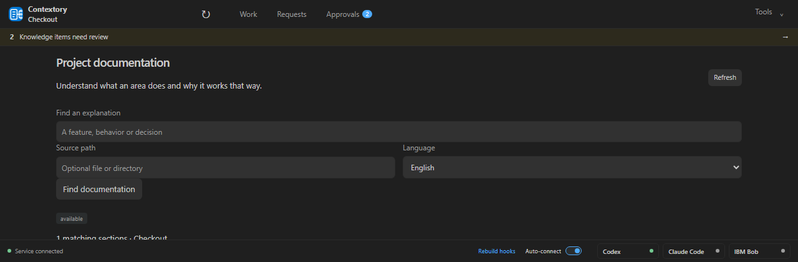

<!-- Generated from .documentation/project.json; edit the bilingual corpus. -->

# Project documentation

## Find an explanation

Contextory includes project documentation as an optional capability. The software-documentation 1.0.1 runtime, its authoring/update/source-comment/integration playbooks and the complete Carbon 1.0.0 module ship in the extension and CLI. Local fonts, tokens, templates and references need no separate plugin installation. Reading explanations works without Python; generation uses Python 3.11+ configured by contextory.pythonExecutable.

1. Choose Tools > Documentation. Search for a feature or behavior, optionally filter by source path, and choose English or Portuguese.
2. Read the explanation, stable page/section ID, source links and freshness badge. A draft, an unknown baseline and a stale explanation still need review; documentation never grants approval to a requirement.
3. From Architecture, choose Explain this area for the current source scope. In a request, expand Brief & actions and choose Related documentation to find sections linked to the request or its descendant records. Reference codebases remain a separate read-only source scope.

Production documentation browser with isolated fixture explanations and explicit stale-source state.

## Author and build with your agent

1. Ask the agent to use contextory-documentation. It reads current source, catalog and the relevant exported Contextory datasets with their project identity and approval/history provenance.
2. Map the project and author substantive paired English/pt-BR explanations in .documentation/project.json. The bundled init operation creates a draft, not finished documentation. Preserve existing content, translations, IDs, URLs and assets.
3. Use contextory_docs_run for map/init/validate/build/integrations/migrate/readme/Pages operations and poll the returned job. Generation runs on demand and cannot gate service startup. Mutating operations require the agent’s current specification lease.
4. Review the generated responsive Carbon site, both locales, local search, examples, native source comments and coverage gaps. Consumer bundles include their own read-only documentation MCP and installer. Do not claim complete behavior coverage from file counts or a passed build.

The generator creates schema 2 Carbon sites, and retrieval also reads schema 1. Migration previews by default, creates a backup on apply and leaves migrated content in draft for review. Contextory’s own schema-1 site build remains separately pinned; this feature does not upgrade that corpus.

## Connect explanations to changes

After comparing a section with current sources, the agent uses contextory_docs_link with its page/section IDs, current corpus fingerprint, local record IDs and a reason. Contextory retains citation hashes, record revisions, semantic fingerprints and an audit trail of before/after associations. It stores these observed links in the selected project’s ledger; it does not inject private ledger history into public HTML.

Changed text/citations, changed or missing cited files and meaningful changes to linked records mark a section stale. Lease renewal alone does not invalidate the explanation. Current-project code context includes bounded relevant explanations when its token budget permits. Source definitions, generated architecture, authored explanations, historical decisions and human-approved requirements retain different authority.

Expand Keep documentation current for source mapping or validation. A successful runtime job can return valid=false, shown as needs review. Large results are retained as JSON artifacts and can be paged through project export. Exact operation retries recover the same job; failed/interrupted mutations are never replayed automatically.

## Publish explicitly and verify

Implementing documentation does not publish a connected project. With publication authorization, inspect pages_plan, select the intended remote, then run pages_publish with publish=true and the current lease. Verify pages_status against the actual live artifact. The bundled upstream publisher preserves orphan gh-pages history and rejects foreign branch replacement. GitHub CLI authentication/network/Pages availability remain environmental requirements.

Missing Python affects generator jobs only. Configure its executable and start a new operation after inspecting any partial files. A failed or unavailable documentation corpus does not block source context or the service. Human approvals remain in Approvals, and references never grant writes into another project.

## Sources

- src/documentation/manager.ts
- src/documentation/reader.ts
- src/documentation/bridge.py
- src/contracts/tools.ts
- src/webview/documentation.ts
- src/webview/main.ts
- resources/documentation/PROVENANCE.json
- skills/contextory-documentation/SKILL.md
- tests/integration/documentation.test.ts
- tests/ui/documentation.spec.ts
- scripts/documentation-resources.mjs
- scripts/build.mjs
- scripts/licenses.mjs
- tests/documentation/embedded.test.mjs
