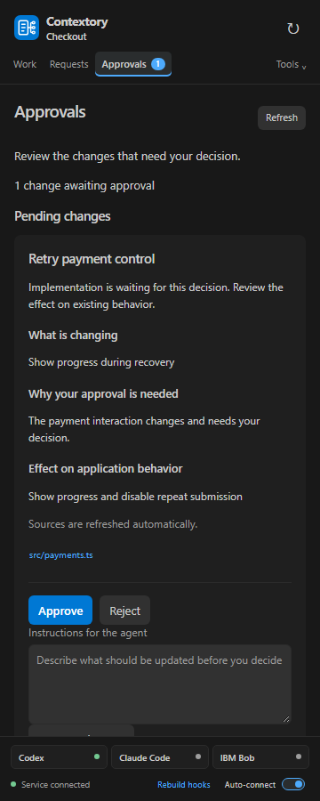
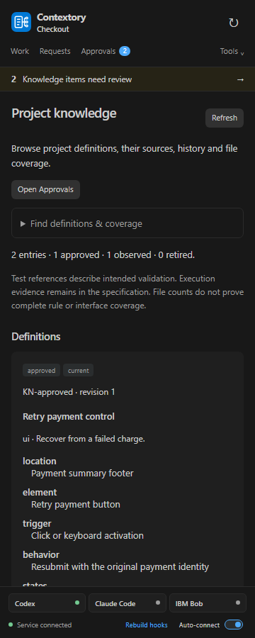

<a id="what-the-catalog-records"></a>
<a id="review-and-change-a-definition"></a>
<a id="migrate-an-existing-project"></a>
<a id="generate-application-documentation-through-mcp"></a>

<!-- Generated from .documentation/project.json; edit the bilingual corpus. -->

# Governed project knowledge

<a id="catalog-contract"></a>

## Describe intended application behavior

| Category | Required content |
| --- | --- |
| File | One source file and its responsibility |
| Rule | Invariant or condition; source and tests, or an explicit testGap |
| Feature | Observable capability; source and tests, or an explicit testGap |
| UI | Location, element, trigger, behavior and states; sources and tests or testGap |

Read contextory_catalog_get before related changes and page definitions, proposals and inventory independently. Generated entries begin as observations. A source graph describes possible relationships; it cannot approve a rule or infer intended interface behavior.

<a id="review-a-definition"></a>

## Review pending items in Approvals

The persistent review alert, Approvals count and editor badge count pending change proposals only. Optional observed baselines remain available in Approvals without blocking work. Notifications are deduplicated per project and exact pending revisions.

1. Open Approvals and read the agent’s explanation: what changes, why your approval is needed and how application behavior changes. Knowledge remains the browser for definitions, source coverage and immutable history.
2. Choose Approve or Reject without entering a comment. To ask for an update first, write your instructions and choose Request changes. A proposal with requested changes still blocks implementation; the agent revises that same proposal and waits for another decision.
3. Readable source snapshots refresh automatically and never grant approval or change the authored definition. Prior source hashes remain in history. Missing files still block approval. An edit during review refreshes the snapshot and asks you to inspect the latest item before retrying; no refresh button or refresh comment is required.

Saving, errors and success appear beside the controls. Failed responses preserve your instructions, and duplicate submissions are disabled. Switching to Knowledge and back preserves the draft; Knowledge filters do not hide approvals. Technical before/after definitions remain available through Definition history rather than filling the review card.



Approvals rendered by the production webview with isolated example records; no real project approval was performed.

Human review in Approvals approves exact process/outcome changes and optional baselines. Agents use the leased auto-approval path for implementation maintenance/conflicts and cannot borrow human credentials. Pending proposals and stale affected approved definitions block completion. A compatible source refresh preserves the original human review and approved behavioral text; a changed file hash alone does not require changing the contract.

<a id="knowledge-browser"></a>

## Browse Knowledge independently

1. Choose Tools > Knowledge to browse current and historical definitions, their source/test links and history.
2. Expand Find definitions & coverage, then filter by text, path or category. File inventory stays available in this browser.
3. Choose Approvals to review pending items. Knowledge filters and pagination do not affect that queue; reviewed items disappear from Approvals and remain discoverable in Knowledge.



Knowledge browser using production UI and isolated fixture records.

<a id="migrate-existing-knowledge"></a>

## Bootstrap an existing project

Use the portable contextory-migrate skill within an authorized implementation request. contextory_catalog_migrate captures a bounded manifest and resumes by migrationId/cursor. Repeating the same operation/input returns the stored result. state=scanned means the file scan ended; it does not mean semantic review or approval is complete.

Inspect candidates against current source, callers, tests and historical decisions. Preserve contradictions, missing tests and unsupported runtime observations as explicit gaps. Reconcile files added after the captured manifest.

<a id="documentation-export"></a>

## Export stored documentation datasets

Discover and page project exports

```json
{ "section": "overview", "offset": 0, "limit": 20 }
```

Call contextory_project_export with the selected projectId. Page records, revisions, history, relationships, code_files, code_nodes, code_edges, code_imports, jobs, usage and artifacts until nextOffset=null. Keep sequence/snapshot, current versus historical state, provenance and source freshness. Artifacts use 400-character units; other datasets page rows.

This export excludes credentials, native conversations and numeric embedding vectors. Large responses may return artifact handles for further paging. A read-only export needs no implementation request.

<a id="behavior-aware-approval"></a>

## Choose approval by behavioral impact

Compatible maintenance needs no new human decision. Agents may auto-approve implementation conflicts too, with an explicit conflict assessment, rationale, source/test links and validation. Conflicts involving process rules or results, changed approved behavior, retirements and uncertain conflicts require human review before implementation. New observations have optional baseline review and do not trigger mandatory approval alerts.

Compatible source maintenance under the current lease

```json
{
  "action": "revise",
  "id": "KN-existing",
  "expectedRevision": 2,
  "specId": "SPEC-current",
  "leaseId": "current-lease",
  "operationId": "unique-operation-id",
  "compatibility": "preserved",
  "impact": "implementation",
  "autoApprove": true,
  "content": {
    "category": "feature",
    "title": "Stable greeting",
    "description": "Returns the configured greeting.",
    "sources": [
      {
        "path": "src/greeting.ts",
        "symbol": "greet"
      }
    ],
    "tests": [
      {
        "path": "tests/greeting.test.ts"
      }
    ]
  },
  "reason": "Function A replaced by B with the same results, errors and side effects; record the relevant validation."
}
```

Use compatibility=conflicting and impact=implementation only when the conflict cannot affect process rules or results. Preserve approved behavior descriptions and UI contracts exactly; file-purpose prose may be corrected for implementation changes. The server declines auto-approval for changed approved behavior, rule conflicts and process/outcome or unclassified related decisions. decisionIds retains links to earlier decisions. Auto-approval is an agent assessment, not proof of semantic equivalence or passing tests.

Every revision preserves the original definition, before/after source fingerprints, target revision, reason, spec, actor and review mode. Auto-approved changes have state=auto_approved; observed targets remain observed and approved behavioral targets retain their original human review. Knowledge displays agent maintenance provenance, and history, search, reports and project export retain the change. Test references never substitute for independent executed evidence.

Auto-approval preserves behavioral descriptions and UI contracts even on observed entries. When an approved file-purpose description changes, the new file observation is not attributed to the earlier human review; its approved baseline revision remains traceable.

<a id="wait-for-review"></a>

## Wait before implementing a disputed change

Prepare the concrete proposal before editing disputed behavior. PreToolUse denies implementation tools while any project proposal is pending; Stop blocks completion. Read-only tools, catalog preparation, configured checks, questions/wait and lease renewal remain available. Contextory also rejects workflow mutations through its service, so direct MCP calls do not bypass the gate. Do not busy-poll or use another shell to proceed. Approval status is re-read on each event and survives service restarts; silence and timeout never approve anything.

Codex/Claude launchers emit structured deny/block responses plus exit code 2; Bob uses blocking stderr/exit code 2. A failed or obsolete approval-status contract blocks implementation/completion until recovery. Reload the service and native hook runtime together after upgrading. Native trust and actual hook delivery remain host-owned. Generic MCP has no native file-tool hook: the service enforces its own workflow, while agents must honor the wait for external edits. Hooks cannot intercept unreported changes, a human editor, or a client that never invokes them.

After approval, implement and validate the accepted behavior. After rejection, retain or restore the established behavior and validate it. Superseding process/outcome or unclassified decisions requires a human-approved proposal in the current spec, with the old decision in decisionIds and the exact replacement choice as content.description; pass its approvalId to contextory_decision_record. Only implementation-to-implementation decision conflicts auto-review.

<a id="trace-a-regression"></a>

## Trace a regression to a recorded change

1. Recover the affected feature/rule/UI contract, current source and last known working check or version. Record the symptom and reproducer as a finding.
2. Follow impact/path relationships and search by feature, path/symbol, catalog ID and earlier decisions. Page history and inspect exact before/after revisions, hashes, agent or human review, spec and evidence, including auto-approved changes.
3. Compare actual Git membership and the last working source. Reproduce candidate causes; static edges and recording intervals do not prove causation or shipped inclusion. Use a focused regression check and Git history/bisect when useful.
4. Link the confirmed finding/fix to the responsible change/spec/source with contextory_relationship_change. Record uncertainty if the cause is unproven; update catalog/docs and submit current independent evidence.

Auto-approval reduces interruptions, not traceability. All material changes still require indexed explanations and validation evidence so a later agent can investigate what changed and why.

<a id="conversation-continuity"></a>

## Return to the originating conversation

Attach the exact native session ID supplied by the Contextory hook. The project, provider, session and specification are saved on proposals and retained on claimed work after lease release. Approval, rejection and feedback are durable audit events returned only to that exact provider/session in the same project. An unknown origin remains unbound; the extension never guesses the active chat.

A trusted PreToolUse or Stop hook can wait up to four minutes for your decision and return it to that conversation. Approval releases the approved operation; rejection prevents the waiting operation, and feedback asks for a revised proposal. Expiry or service failure keeps the operation blocked. Responses remain queued until a matching hook receives them; transport acknowledgement does not prove the model acted on them. Hooks that are not trusted or a fully stopped client cannot resume automatically.

Use Reopen conversation on an approval or a specification’s Contract tab. Claude opens the saved session through the installed native extension command. Codex resumes that exact saved conversation in an interactive terminal with codex resume, because its documented extension commands expose neither targeted reopening nor targeted message submission. Bob, generic clients or an unavailable Claude command copy the saved session ID for manual history recovery. The native client owns history availability and permissions; no response is injected into an arbitrary chat.

[Claude session recovery contract](https://code.claude.com/docs/en/vs-code#launch-a-vs-code-tab-from-other-tools)

[Documented Codex extension commands](https://developers.openai.com/codex/ide/commands)

## Sources

- src/knowledge/catalog.ts
- src/knowledge/catalog.ts
- src/knowledge/export.ts
- src/webview/catalog.ts
- tests/integration/catalog.test.ts
- src/extension.ts
- src/service/reconnect.ts
- src/service/rpc.ts
- src/webview/progress.ts
- tests/ui/console.spec.ts
- tests/integration/recipe-configuration.test.ts
- scripts/verify-background-startup.mjs
- tests/ui/catalog.spec.ts
- src/webview/main.ts
- src/hooks/approval.ts
- src/hooks/launcher.ts
- src/core/workflow.ts
- tests/integration/approval-policy.test.ts
- skills/contextory-workflow/references/approvals-and-regressions.md
- src/core/conversations.ts
- src/providers/conversations.ts
- src/hooks/review-wait.ts
- src/service/server.ts
- tests/integration/approval-conversations.test.ts
