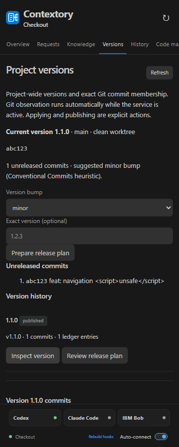

<a id="prepare-apply-and-publish"></a>
<a id="global-changelog-and-documentation"></a>
<a id="cli-and-mcp-automation"></a>

<!-- Generated from .documentation/project.json; edit the bilingual corpus. -->

# Project versions and releases

<a id="automatic-observation"></a>

## Inspect repository-wide version history

Versions belongs to the whole repository, independently of requests, specs and leases. While the service runs, it observes Git and records exact commit membership for releases and unreleased changes. Read contextory_version_get or the Versions view and page commits and semantic records separately. Local tag observation does not prove remote publication.



Versions captured from the application.

<a id="prepare-apply-publish"></a>

## Prepare, apply and publish separately

1. Prepare a concrete release plan: inspect proposed version, HEAD, changed version files and changelog. Preparation does not edit source.
2. With authorization for the release, apply the reviewed plan to create its version commit and annotated local tag. Resolve stale plans or unrelated dirty changes before applying.
3. Publish the exact tag as a separate action using the configured Git remote and authentication. Verify remote state. Local application alone does not publish extension packages, releases or the documentation site.
4. After an uncertain result, recover the owned operation with its original operation ID/input. Never force or replace an existing tag. Cancel only an untouched plan.

Inspect and prepare; use returned IDs/revisions for later actions

```powershell
node dist/contextory.mjs versions
node dist/contextory.mjs release-prepare minor --operation prepare-unique-id
node dist/contextory.mjs versions REL-ID --offset 0 --limit 20
```

> Implementing software or rewriting documentation does not authorize releasing the repository. Release publication and a live editor installation remain separate user actions.

<a id="configuration"></a>

## Configure version adapters

contextory.release.json supports schemaVersion, initialVersion, tagPrefix, remote, optional branch, changelogPath and versionFiles. JSON adapters select key paths; text adapters use bounded prefix/suffix replacements. Use repository-relative ordinary files. Plans bind the exact source/configuration state and preserve unrelated changes.

Semantic records associated between release cutoffs remain interval associations, not proof they shipped in a commit. Release revisions and history remain exportable.

## Sources

- src/releases/manager.ts
- src/releases/git.ts
- src/releases/config.ts
- src/webview/versions.ts
- tests/integration/releases.test.ts
