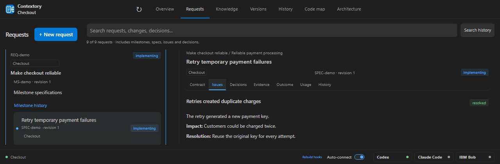

<!-- Generated from .documentation/project.json; edit the bilingual corpus. -->

# Write useful implementation outcomes

## Explain what changed and why

- Identify the request/spec, current revision and original user intent. Describe the resulting behavior with source references.
- Record findings with impact, resolution and why the fix works. Explicitly say when there were no findings.
- Explain material choices, alternatives and consequences. Distinguish an agent decision from a human requirement.
- Map every current criterion exactly once to current evidence. Retain actual command/job result, origin, skips and limits.
- Include catalog.recordIds and catalog.explanation when the catalog exists. Explain updated definitions or unchanged behavior.

## Submit and explicitly complete

1. Finish source/configuration edits before final independent checks. Later changes can invalidate evidence.
2. Submit contextory_outcome_submit with the current revision, evidence mappings, report/changelog text and limitations.
3. Use contextory_spec_change action=complete with the returned revision and a new operationId. Confirm state=completed and export the request report.

Requests in a horizontal editor Panel.

## Sources

- src/contracts/tools.ts
- src/core/workflow.ts
- src/core/report.ts
- tests/core/workflow.test.ts
