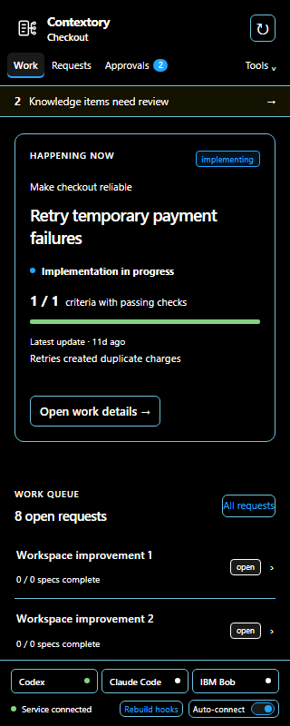

# Daily user guide

## Multiple projects in one workspace

Open up to 16 trusted local, non-nested folders. The Project selector scopes Requests, Approvals, Knowledge, History, Versions and Architecture. Records, checks, evidence, source graphs, reference repositories and releases belong to each project independently. Removing a folder detaches it while retaining its storage.

1. In New request, select every affected project. Each selected project receives its own linked local request.
2. Inspect Across projects for branch status. Each branch needs its own milestones, specs, lease, checks and completed outcome.
3. If creation partially succeeds, use Retry missing branches on the original owner. Retain the original operation ID and inputs in agent automation. Missing or offline branches keep the group incomplete.


Requests in a horizontal editor Panel.

## Prepare connections at startup

Service startup and native bridge preparation run when the extension activates, even while Explorer or another sidebar is visible. Trust, folder, installed-agent and repaired runtime changes enter the same recovery path. Auto-connect pauses remain respected.

Auto-connect defaults to on and contextory.startupAgent defaults to auto, preparing all detected supported agents. Use the footer Auto-connect switch to pause automatic setup. Existing connections, sessions and records remain available. A manually disconnected provider stays opted out until reconnected.

Startup choices are auto, last-used, codex, claude, bob and none. Contextory prepares workspace-local configuration; native clients control trust, MCP reload, sign-in and session startup.



Contextory sidebar captured from the application; records are examples.

## Configure checks

Example workspace recipe

```json
{
  "contextory.checks": [{
    "id": "unit", "name": "Unit tests",
    "executable": "node", "args": ["--test"], "timeoutMs": 120000
  }]
}
```

Use executable plus argument arrays for real project checks. The agent invokes a configured recipe, polls its job and maps independently produced evidence to each current criterion. Source, contract or attempt changes can invalidate older evidence.

Configure up to 256 recipes. Invalid settings show Fix check settings while keeping the service connection and last valid recipe list. A fresh service has no valid recipes until configuration succeeds.

## Read model and usage records

The Usage section in Specification details and contextory_usage_get show observed metadata. Codex can report per-request token counts, Claude provides model metadata, and Bob’s documented hooks currently supply neither. Missing counts remain unavailable. Session/lease correlation is exact; unassigned observations remain unassigned.

Counts are not billing or quota estimates. Cached and reasoning tokens are subsets. Contextory does not read or mirror native conversations to calculate usage.

## Recover a connection or existing chat

1. Keep the project editor open and run Contextory: Check Native Connections. Read current-service MCP and hook observations in Output > Contextory.
2. Ask the existing agent to rediscover its advertised tools and make a read-only workspace/context call. If tools are missing, use Contextory: Restart Agent Extensions and reopen the chat as needed.
3. For missing or stale hooks, use Rebuild hooks in the footer or Contextory: Rebuild Agent Hooks. Select the project/provider, inspect repaired files and review native hook trust.
4. After one unchanged repair, inspect native trust and service logs. Repeating repairs cannot approve hooks. On Codex, /hooks approvals can differ for C: and c: path casing.

The proxy keeps discovery available during delayed startup and retries readiness for up to five minutes, with foreground waits bounded to 15 seconds. It rereads descriptors after restarts and never automatically replays a dispatched mutation. A contract mismatch needs the displayed reload/restart action.

## Project explanations

Use Tools > Documentation to find explanations linked to current source and tracked work. The bundled documentation/Carbon capability requires no external plugin; generation runs on demand.

[Read the project documentation guide](documentation.md)

## Sources

- src/webview/main.ts
- src/providers/clients.ts
- src/providers/registration.ts
- src/service/workspace.ts
- src/core/usage.ts
- tests/ui/workspace.spec.ts
- src/extension.ts
- src/service/reconnect.ts
- src/service/rpc.ts
- src/webview/progress.ts
- tests/ui/console.spec.ts
- tests/integration/recipe-configuration.test.ts
- scripts/verify-background-startup.mjs

