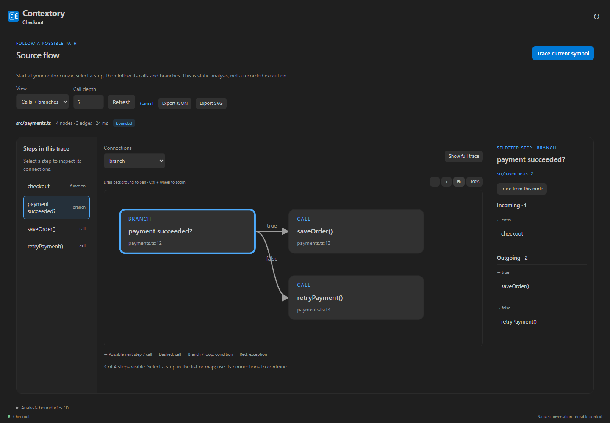
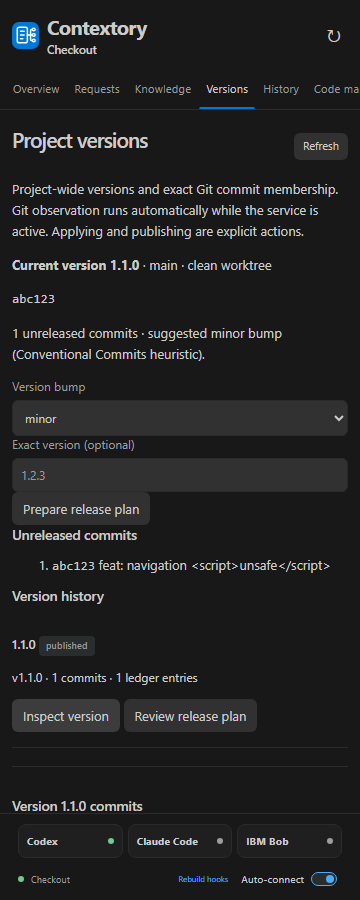
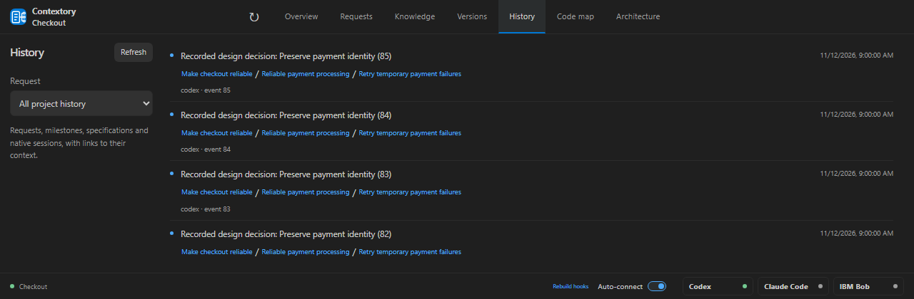

# Interface walkthroughs

## Overview and Requests

1. Open Contextory and select the owning Project. Overview shows open requests, spec progress and the three most recent activities; an empty workspace invites you to create a request.
2. Open Requests and choose + New request. Enter Title and What should change?, select affected projects if needed, then choose Create request.
3. Expand a milestone and select its spec. Inspect Contract, Issues, Decisions, Evidence, Outcome, Usage and History. Search history also searches descendant explanations.
4. Use Explore relationships to open linked records and source locations. Export a report when you need a durable handoff.

Requests in a horizontal editor Panel.

While a project switches, the UI shows Switching project and ignores replies from the previous project. Switching projects clears unfinished form drafts. During an operation, a progress indicator and status notice report activity or failure.

## Inspect architecture and source flow

1. Open Architecture or run Contextory: Explore Architecture. Select a subsystem, file and symbol in the coordinated map, tree and inspector.
2. Use Explore connections and the relationship/direction filters. Matrix rows depend on columns; a reciprocal marker identifies direct dependencies in both directions.
3. For detailed flow, place the editor cursor in a source function and run Contextory: Trace Flow from Here, or use Code map. Select a step to inspect calls, branches and source.
4. Use zoom, Fit, background drag and source buttons. If no indexed connections appear, choose another scope or Refresh code index and review coverage notices.

Architecture explorer captured from Contextory.

Bounded source-flow explorer in Contextory.

## Review Knowledge and Versions

1. Open Knowledge. Filter entries by category, text or source path and inspect the definition, tests and freshness.
2. For an observed baseline or pending change, read the exact proposal and enter a review reason before Approve baseline, Approve change or Reject. Only a human uses these review controls.
3. Open Versions to inspect current version, commits and release plans. Review version/file/changelog edits before applying a plan. Publish is a separate action that needs release authorization.

Versions captured from the application.

[Understand definition review and source freshness](knowledge.md)

[Understand release planning and publication](releases.md)

## History, layout and keyboard use

1. Open History or Full history from Overview. Filter to a request, milestone or spec, then use Load older activity to page earlier events.
2. To use the horizontal layout, move Workspace Tasks to the editor Panel and resize it. Wide, short views place the request list beside the specification inspector.
3. Use Tab to reach controls, Enter or Space to activate map nodes, arrow keys on focused canvases and Ctrl+wheel to zoom. The interface follows the current editor theme and high-contrast colors.

Project history in the editor Panel.

Resizing or docking preserves selection and drafts within the same project. Initial/loading/error/disabled states remain tied to the selected project and available service. Published screenshots are genuine existing application captures, with example records; they were not recaptured in an authenticated native chat during this rewrite.

## Sources

- src/webview/main.ts
- src/webview/architecture.ts
- src/webview/flow.ts
- src/webview/catalog.ts
- src/webview/versions.ts
- tests/ui/sidebar.spec.ts
- tests/ui/catalog.spec.ts

