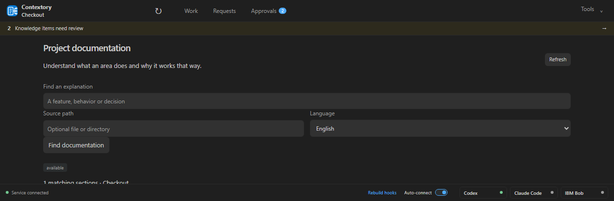

# Documentação do projeto

## Encontre uma explicação

O Contextory inclui documentação de projetos como recurso opcional. O runtime software-documentation 1.0.1, seus guias de autoria/atualização/comentários/integração e o módulo Carbon 1.0.0 completo são distribuídos na extensão e CLI. Fontes, tokens, modelos e referências locais dispensam instalação de outro plugin. A consulta funciona sem Python; a geração usa Python 3.11+ configurado em contextory.pythonExecutable.

1. Escolha Tools > Documentation. Busque uma funcionalidade ou comportamento, filtre opcionalmente pelo caminho de origem e escolha inglês ou português.
2. Leia a explicação, o ID estável da página/seção, os vínculos de origem e o estado de atualização. Rascunhos, baselines desconhecidos e explicações desatualizadas precisam de revisão; documentação nunca aprova um requisito.
3. Em Architecture, escolha Explain this area para a área de origem atual. Em um pedido, expanda Brief & actions e escolha Related documentation para encontrar seções vinculadas ao pedido ou a seus registros descendentes. Repositórios de referência permanecem em escopo separado de leitura.

Navegador de documentação de produção com explicações isoladas de teste e indicação explícita de origem desatualizada.

## Escreva e gere com seu agente

1. Peça ao agente para usar contextory-documentation. Ele consulta as fontes, o catálogo e os dados exportados relevantes com identidade do projeto e proveniência de aprovação/histórico.
2. Mapeie o projeto e escreva explicações substantivas em inglês/pt-BR em .documentation/project.json. A inicialização incluída cria um rascunho, não documentação pronta. Preserve conteúdo, traduções, IDs, URLs e assets existentes.
3. Use contextory_docs_run para operações de mapa/inicialização/validação/geração/integrações/migração/README/Pages e consulte o job retornado. A geração acontece sob demanda e não bloqueia a inicialização do serviço. Mutações exigem o lease atual da especificação do agente.
4. Revise o site Carbon responsivo, ambos os idiomas, busca local, exemplos, comentários nativos e lacunas de cobertura. Bundles consumidores incluem MCP de documentação somente leitura e instalador próprios. Não deduza cobertura comportamental completa de contagens ou builds aprovados.

O gerador cria sites Carbon com schema 2, e a consulta também lê schema 1. A migração gera prévia por padrão, cria backup ao aplicar e mantém o conteúdo em rascunho para revisão. O build do próprio site schema-1 do Contextory continua fixado separadamente; este recurso não atualiza esse corpus.

## Conecte explicações às mudanças

Após comparar uma seção com as fontes atuais, o agente usa contextory_docs_link com IDs de página/seção, fingerprint atual do corpus, IDs de registros locais e motivo. O Contextory preserva hashes de citações, revisões de registros, fingerprints semânticos e histórico de associações antes/depois. Os vínculos observados ficam no ledger do projeto selecionado; histórico privado não é inserido no HTML público.

Texto/citações alterados, arquivos citados alterados ou ausentes e mudanças significativas em registros vinculados marcam a seção como desatualizada. Renovar um lease não invalida a explicação. O contexto de código do projeto inclui explicações relevantes e limitadas quando o orçamento permite. Definições de origem, arquitetura gerada, explicações autorais, decisões históricas e requisitos aprovados preservam autoridades diferentes.

Expanda Keep documentation current para mapear fontes ou validar. Um job executado pode retornar valid=false, exibido como needs review. Resultados grandes ficam em artefatos JSON consultáveis por páginas na exportação. Repetir a operação exata recupera o mesmo job; mutações interrompidas/com falha não são repetidas automaticamente.

## Publique explicitamente e verifique

Implementar documentação não publica um projeto conectado. Com autorização de publicação, consulte pages_plan, selecione o remoto e execute pages_publish com publish=true e lease atual. Verifique pages_status contra o artefato publicado. O publicador incluído preserva o histórico órfão de gh-pages e recusa substituir branches alheias. Autenticação do GitHub CLI, rede e disponibilidade do Pages continuam requisitos do ambiente.

Python ausente afeta apenas jobs de geração. Configure o executável e inicie nova operação após inspecionar arquivos parciais. Corpus indisponível ou inválido não bloqueia o contexto de origem nem o serviço. Aprovações humanas continuam em Approvals e referências não autorizam escrever em outro projeto.

## Fontes

- src/documentation/manager.ts
- src/documentation/reader.ts
- src/documentation/bridge.py
- src/contracts/tools.ts
- src/webview/documentation.ts
- src/webview/main.ts
- resources/documentation/PROVENANCE.json
- skills/contextory-documentation/SKILL.md
- tests/integration/documentation.test.ts
- tests/ui/documentation.spec.ts
- scripts/documentation-resources.mjs
- scripts/build.mjs
- scripts/licenses.mjs
- tests/documentation/embedded.test.mjs

