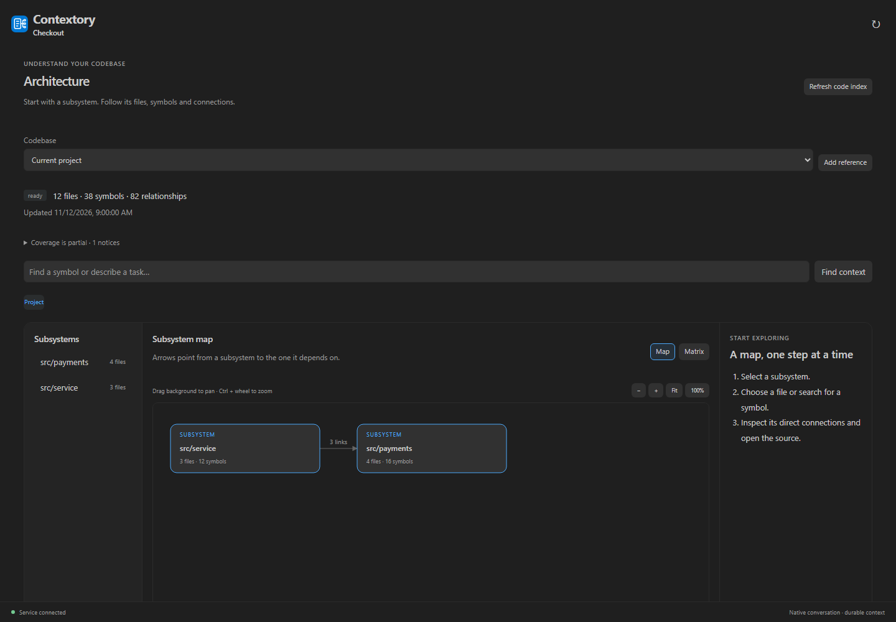

# O que o Contextory oferece

## Escolha uma funcionalidade

| Funcionalidade | Resultado |
| --- | --- |
| Pedidos, marcos e especificações | Intenção original, critérios de aceite, dependências, revisões e conclusão verificada |
| Memória de projeto | Problemas, correções, escolhas, alternativas, evidências e relatórios de resultado |
| Projetos do workspace | Registros e grafos de código separados; pedidos vinculados entre pastas escolhidas explicitamente |
| Architecture e Code map | Navegação de código, dependências entre subsistemas, contexto de tarefas e fluxo limitado de chamadas e desvios |
| Knowledge com governança | Responsabilidades de arquivos, vínculos entre regras/funcionalidades/testes e definições de interação com revisão humana |
| Versions | Observação Git do repositório inteiro, planos de release, tags locais e publicação autorizada separadamente |
| Busca e relatórios | Busca lexical, recuperação semântica local opcional, histórico paginado e exportações de pedidos |
| Integrações nativas e portáteis | Adaptadores Codex/Claude/Bob, skills compartilhadas, MCP genérico e CLI independente |

[Seguir os guias da interface](walkthroughs.md)

[Usar fluxos avançados de código e workspace](advanced.md)

## Leia os resultados com seus limites

1. Selecione o Project responsável antes de inspecionar registros. Preserve a identidade do projeto ao copiar citações ou exportar resultados.
2. Leia avisos de cobertura, atualização e truncamento junto aos resultados de código. Refine o escopo ou siga a paginação antes de concluir.
3. Use verificações executadas de forma independente para validar uma especificação. Referências de testes e diagramas de código descrevem relações possíveis.

Explorador Architecture capturado do Contextory.

## Fontes

- src/webview/main.ts
- src/core/workflow.ts
- src/knowledge/catalog.ts
- src/releases/manager.ts
- src/codebase/queries.ts
- src/extension.ts
- src/service/reconnect.ts
- src/service/rpc.ts
- src/webview/progress.ts
- tests/ui/console.spec.ts
- tests/integration/recipe-configuration.test.ts
- scripts/verify-background-startup.mjs

