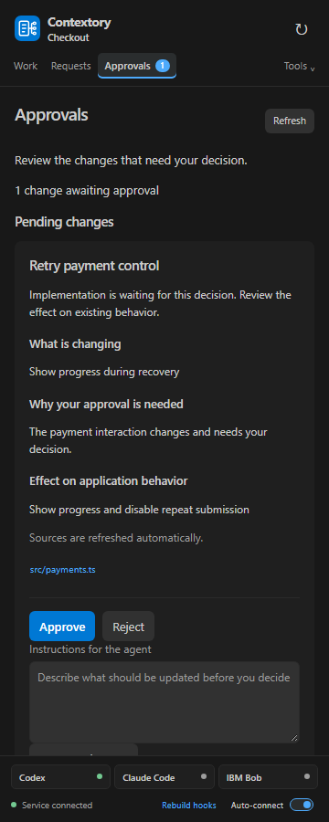
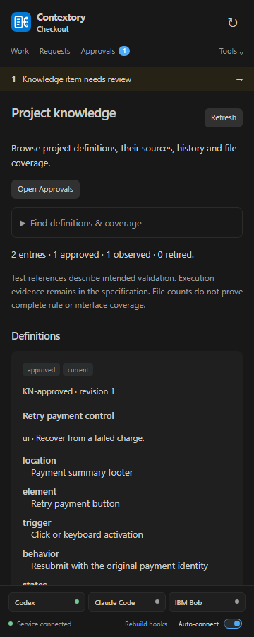

# Conhecimento de projeto com governança

## Descreva o comportamento esperado da aplicação

| Categoria | Conteúdo exigido |
| --- | --- |
| Arquivo | Um arquivo de código e sua responsabilidade |
| Regra | Invariante ou condição; fontes e testes ou testGap explícito |
| Funcionalidade | Capacidade observável; fontes e testes ou testGap explícito |
| Interface | Localização, elemento, gatilho, comportamento e estados; fontes e testes ou testGap |

Leia contextory_catalog_get antes de alterações relacionadas e pagine definições, propostas e inventário de forma independente. Entradas geradas começam como observações. Um grafo descreve relações possíveis; ele não aprova regras nem infere o comportamento esperado da interface.

## Revise itens pendentes em Approvals

O alerta persistente, a contagem de Aprovações e o badge do editor contam somente propostas de alteração pendentes. A revisão opcional da linha de base começa recolhida; expanda o resumo com clique ou teclado para inspecionar observações. O estado escolhido é mantido ao atualizar e navegar. Essas observações não bloqueiam o trabalho.

1. Abra Aprovações e leia a explicação do agente: o que muda, por que sua aprovação é necessária e como o comportamento da aplicação muda. Conhecimento continua sendo o navegador de definições, cobertura das fontes e histórico imutável.
2. Escolha Aprovar ou Rejeitar sem informar um comentário. Para pedir um ajuste antes, escreva suas instruções e escolha Solicitar ajustes. Uma proposta com ajustes solicitados continua bloqueando a implementação; o agente revisa a mesma proposta e aguarda outra decisão.
3. Snapshots de fontes legíveis são atualizados automaticamente e nunca concedem aprovação nem alteram a definição escrita. Hashes anteriores permanecem no histórico. Arquivos ausentes continuam bloqueando a aprovação. Uma edição durante a revisão atualiza o snapshot e pede que você confira o item mais recente antes de tentar novamente; não há botão nem comentário de atualização obrigatório.

Salvamento, erros e sucesso aparecem ao lado dos controles. Respostas com falha preservam suas instruções, e envios duplicados são desabilitados. Alternar para Conhecimento e voltar preserva o rascunho; os filtros não ocultam aprovações. Definições técnicas antes/depois permanecem disponíveis em Histórico da definição, sem ocupar o cartão de revisão.



Approvals renderizado pela webview de produção com exemplos isolados; nenhuma aprovação real do projeto foi realizada.

A revisão humana em Approvals aprova mudanças exatas de processo/resultado e linhas de base opcionais. Agentes usam o fluxo com lease para aprovação automática de manutenção/conflitos de implementação e não podem usar credenciais humanas. Propostas pendentes e definições aprovadas afetadas e obsoletas bloqueiam a conclusão. Atualizar fontes de forma compatível preserva a revisão humana e o texto comportamental aprovado; alterar um hash não exige mudar o contrato.

## Consulte Knowledge separadamente

1. Escolha Tools > Knowledge para consultar definições atuais e históricas, seus vínculos com fontes/testes e seu histórico.
2. Expanda Find definitions & coverage e filtre por texto, caminho ou categoria. O inventário de arquivos continua disponível nesse navegador.
3. Escolha Approvals para revisar pendências. Os filtros e a paginação de Knowledge não afetam essa fila; itens revisados saem de Approvals e continuam disponíveis em Knowledge.



Navegador Knowledge usando a interface de produção e registros isolados de teste.

## Crie a linha de base de um projeto existente

Use a skill portátil contextory-migrate dentro de um pedido de implementação autorizado. contextory_catalog_migrate captura um manifesto limitado e retoma por migrationId/cursor. Repetir a mesma operação/entrada retorna o resultado armazenado. state=scanned indica o fim da varredura; não significa revisão semântica ou aprovação concluída.

Inspecione candidatos contra código atual, chamadores, testes e decisões históricas. Preserve contradições, testes ausentes e observações de runtime indisponíveis como lacunas explícitas. Reconcilie arquivos adicionados depois do manifesto capturado.

## Exporte os conjuntos de documentação armazenados

Descobrir e paginar exportações do projeto

```json
{ "section": "overview", "offset": 0, "limit": 20 }
```

Chame contextory_project_export com o projectId escolhido. Pagine records, revisions, history, relationships, code_files, code_nodes, code_edges, code_imports, jobs, usage e artifacts até nextOffset=null. Preserve sequência/snapshot, estado atual versus histórico, proveniência e atualização das fontes. Artefatos usam unidades de 400 caracteres; os outros conjuntos paginam linhas.

A exportação exclui credenciais, conversas nativas e vetores numéricos de embeddings. Respostas grandes podem retornar identificadores de artefatos para paginação adicional. Uma exportação somente leitura não precisa de pedido de implementação.

## Escolher aprovação pelo impacto no comportamento

Manutenção compatível dispensa nova decisão humana. Agentes também podem aprovar automaticamente conflitos de implementação, registrando avaliação do conflito, motivo, fontes/testes e validação. Conflitos com regras de processo ou resultados, mudanças em comportamento aprovado, aposentadorias e conflitos incertos exigem revisão humana antes da implementação. Observações novas têm revisão inicial opcional e não geram alertas de aprovação obrigatória.

Manutenção compatível de fontes com o lease atual

```json
{
  "action": "revise",
  "id": "KN-existing",
  "expectedRevision": 2,
  "specId": "SPEC-current",
  "leaseId": "current-lease",
  "operationId": "unique-operation-id",
  "compatibility": "preserved",
  "impact": "implementation",
  "autoApprove": true,
  "content": {
    "category": "feature",
    "title": "Stable greeting",
    "description": "Returns the configured greeting.",
    "sources": [
      {
        "path": "src/greeting.ts",
        "symbol": "greet"
      }
    ],
    "tests": [
      {
        "path": "tests/greeting.test.ts"
      }
    ]
  },
  "reason": "Function A replaced by B with the same results, errors and side effects; record the relevant validation."
}
```

Use compatibility=conflicting e impact=implementation somente quando o conflito não afetar regras de processo ou resultados. Preserve exatamente as descrições comportamentais e os contratos de interface aprovados; descrições de responsabilidade de arquivo podem acompanhar alterações de implementação. O servidor impede aprovação automática de mudanças comportamentais aprovadas, conflitos de regras e decisões relacionadas de processo/resultado ou sem classificação. decisionIds mantém os vínculos com decisões anteriores. A aprovação automática é uma avaliação do agente, não prova de equivalência semântica ou testes aprovados.

Toda revisão preserva a definição original, fingerprints anteriores/novos, revisão de destino, motivo, especificação, autor e modo de revisão. Mudanças aprovadas pelo agente têm state=auto_approved; observações permanecem observadas e contratos comportamentais aprovados mantêm a revisão humana original. Knowledge mostra a proveniência da manutenção pelo agente; histórico, busca, relatórios e exportação preservam a mudança. Referências de testes não substituem evidências de execução independente.

A aprova??o autom?tica preserva descri??es comportamentais e contratos de interface mesmo em observa??es. Quando a descri??o aprovada de responsabilidade de arquivo muda, a nova observa??o n?o ? atribu?da ? revis?o humana anterior; a revis?o inicial aprovada continua rastre?vel.

## Aguardar antes de implementar uma mudança em disputa

Prepare a proposta concreta antes de editar o comportamento em disputa. PreToolUse nega ferramentas de implementação enquanto houver proposta pendente no projeto; Stop bloqueia a conclusão. Leituras, preparação do catálogo, verificações configuradas, perguntas/espera e renovação de lease continuam disponíveis. O serviço também rejeita mutações de fluxo, impedindo contornar a espera com MCP direto. Não faça consultas contínuas nem use outro shell para prosseguir. O estado é relido a cada evento e persiste entre reinícios; silêncio e timeout nunca aprovam nada.

Os launchers Codex/Claude emitem respostas estruturadas deny/block e código de saída 2; Bob usa stderr e código 2 para bloqueio. Falha ou contrato obsoleto de consulta de aprovação bloqueia implementação/conclusão até a recuperação. Após atualizar, recarregue o serviço e os hooks nativos juntos. Confiança nativa e entrega real dos eventos pertencem ao cliente. MCP genérico não possui hook de ferramentas de arquivo: o serviço impõe seu próprio fluxo, enquanto agentes devem respeitar a espera em edições externas. Hooks não interceptam alterações não registradas, um editor humano ou clientes que não os executem.

Após aprovação, implemente e valide o comportamento aceito. Após rejeição, preserve ou restaure o comportamento estabelecido e valide. Substituir decisões de processo/resultado ou sem classificação exige proposta aprovada por humano na especificação atual, com a decisão anterior em decisionIds e a escolha substituta exata em content.description; informe approvalId a contextory_decision_record. Somente conflitos entre decisões de implementação têm revisão automática.

## Relacionar uma regressão a uma mudança registrada

1. Recupere o contrato da funcionalidade/regra/interface, o código atual e a última verificação ou versão funcional conhecida. Registre o sintoma e a reprodução como um problema.
2. Siga relações de impacto/caminho e busque por funcionalidade, arquivo/símbolo, ID do catálogo e decisões anteriores. Pagine o histórico e examine revisões exatas, hashes, revisão humana ou do agente, especificação e evidências, inclusive alterações aprovadas automaticamente.
3. Compare a inclusão real no Git e o último código funcional. Reproduza causas candidatas; relações estáticas e intervalos de registro não provam causalidade nem inclusão em uma versão. Use uma verificação de regressão e histórico/bisect do Git quando útil.
4. Relacione o problema/correção confirmado à mudança/especificação/fonte responsável com contextory_relationship_change. Registre incerteza se a causa não foi comprovada; atualize catálogo/documentação e envie evidências independentes atuais.

A aprovação automática reduz interrupções, sem reduzir a rastreabilidade. Toda mudança relevante continua exigindo explicações indexadas e evidências de validação para que outro agente investigue o que mudou e por quê.

## Retorne à conversa de origem

Associe o ID nativo exato fornecido pelo hook do Contextory. Projeto, provedor, sessão e especificação são salvos nas propostas e mantidos no trabalho após liberar o lease. Aprovação, rejeição e feedback são eventos de auditoria duráveis retornados apenas ao mesmo provedor/sessão no mesmo projeto. Uma origem desconhecida permanece sem vínculo; a extensão nunca adivinha a conversa ativa.

Um hook confiável PreToolUse ou Stop pode aguardar até quatro minutos pela decisão e retorná-la à conversa. Aprovação libera a operação aprovada; rejeição impede a operação em espera, e feedback pede uma proposta revisada. Expiração ou falha do serviço mantém o bloqueio. Respostas ficam na fila até um hook correspondente recebê-las; confirmar o transporte não prova que o modelo agiu. Hooks sem confiança ou um cliente completamente parado não permitem retomada automática.

Use Reabrir conversa em uma aprovação ou na aba Contrato da especificação. Claude abre a sessão salva pelo comando da extensão nativa instalada. Codex retoma a mesma conversa salva em um terminal interativo com codex resume, pois seus comandos documentados não expõem reabertura nem envio de mensagens para uma conversa específica. Bob, clientes genéricos ou um comando Claude indisponível copiam o ID salvo para recuperação manual no histórico. O cliente nativo controla disponibilidade do histórico e permissões; nenhuma resposta é inserida em uma conversa arbitrária.

[Contrato de recuperação de sessões do Claude](https://code.claude.com/docs/en/vs-code#launch-a-vs-code-tab-from-other-tools)

[Comandos documentados da extensão Codex](https://developers.openai.com/codex/ide/commands)

## Fontes

- src/knowledge/catalog.ts
- src/knowledge/catalog.ts
- src/knowledge/export.ts
- src/webview/catalog.ts
- tests/integration/catalog.test.ts
- src/extension.ts
- src/service/reconnect.ts
- src/service/rpc.ts
- src/webview/progress.ts
- tests/ui/console.spec.ts
- tests/integration/recipe-configuration.test.ts
- scripts/verify-background-startup.mjs
- tests/ui/catalog.spec.ts
- src/webview/main.ts
- src/hooks/approval.ts
- src/hooks/launcher.ts
- src/core/workflow.ts
- tests/integration/approval-policy.test.ts
- skills/contextory-workflow/references/approvals-and-regressions.md
- src/core/conversations.ts
- src/providers/conversations.ts
- src/hooks/review-wait.ts
- src/service/server.ts
- tests/integration/approval-conversations.test.ts

