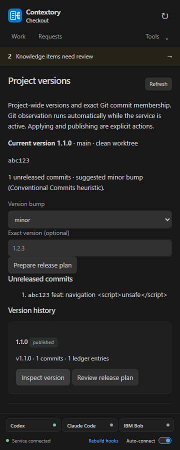

# Versões e releases do projeto

## Inspecione o histórico de versões do repositório

Versions pertence ao repositório inteiro, independentemente de pedidos, especificações e leases. Enquanto o serviço está ativo, ele observa o Git e registra os commits exatos de releases e alterações não lançadas. Consulte contextory_version_get ou Versions e pagine commits e registros semânticos separadamente. Observar uma tag local não comprova publicação remota.



Versions capturado da aplicação.

## Prepare, aplique e publique separadamente

1. Prepare um plano concreto: inspecione a versão proposta, HEAD, arquivos de versão e changelog. A preparação não edita o código.
2. Com autorização para a release, aplique o plano revisado para criar o commit de versão e a tag local anotada. Resolva planos obsoletos ou alterações locais alheias antes de aplicar.
3. Publique a tag exata em uma ação separada usando o remoto Git e autenticação configurados. Verifique o estado remoto. Aplicar localmente não publica pacotes da extensão, releases nem o site de documentação.
4. Depois de um resultado incerto, recupere a operação com seu ID/entrada originais. Nunca force nem substitua uma tag existente. Cancele apenas planos ainda não aplicados.

Inspecionar e preparar; usar IDs/revisões retornados nas próximas ações

```powershell
node dist/contextory.mjs versions
node dist/contextory.mjs release-prepare minor --operation prepare-unique-id
node dist/contextory.mjs versions REL-ID --offset 0 --limit 20
```

> Implementar software ou reescrever documentação não autoriza lançar o repositório. Publicação de release e instalação em um editor ativo continuam sendo ações separadas do usuário.

## Configure adaptadores de versão

contextory.release.json aceita schemaVersion, initialVersion, tagPrefix, remote, branch opcional, changelogPath e versionFiles. Adaptadores JSON selecionam caminhos de chaves; adaptadores de texto usam substituições delimitadas por prefixo/sufixo. Use arquivos comuns relativos ao repositório. Planos vinculam o estado exato das fontes/configuração e preservam alterações alheias.

Registros semânticos associados entre limites de releases continuam sendo associações de intervalo, não prova de inclusão em um commit. Revisões e histórico de releases continuam exportáveis.

## Fontes

- src/releases/manager.ts
- src/releases/git.ts
- src/releases/config.ts
- src/webview/versions.ts
- tests/integration/releases.test.ts
- contextory.release.json

