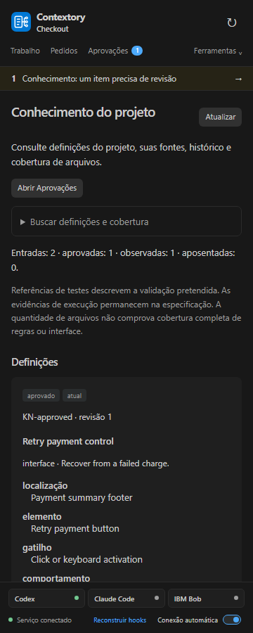

# Guia do usuário

## Vários projetos no mesmo workspace

Abra até 16 pastas locais confiáveis e não aninhadas. O seletor Project delimita Requests, Approvals, Knowledge, History, Versions e Architecture. Registros, verificações, evidências, grafos de código, referências e releases pertencem a cada projeto de forma independente. Remover uma pasta a desconecta, preservando seu armazenamento.

1. Em New request, selecione todos os projetos afetados. Cada projeto selecionado recebe seu próprio pedido local vinculado.
2. Inspecione Across projects para conferir os ramos. Cada ramo precisa de marcos, especificações, lease, verificações e resultado concluído próprios.
3. Se a criação for parcial, use Retry missing branches no responsável original. Preserve o ID da operação e os dados originais na automação do agente. Ramos ausentes ou offline mantêm o grupo incompleto.


Pedidos no Panel horizontal do editor.

## Prepare conexões na inicialização

O serviço e a preparação das conexões nativas iniciam na ativação da extensão, mesmo com Explorer ou outra barra lateral visível. Mudanças de confiança, pastas, agentes instalados e runtime reparado usam a mesma recuperação. Pausas de Auto-connect continuam respeitadas.

Auto-connect vem ativo e contextory.startupAgent usa auto, preparando todos os agentes compatíveis detectados. Use Auto-connect no rodapé para pausar a configuração automática. Conexões, sessões e registros existentes continuam disponíveis. Um agente desconectado manualmente permanece desativado até ser reconectado.

As opções de inicialização são auto, last-used, codex, claude, bob e none. O Contextory prepara a configuração local do workspace; os clientes nativos controlam confiança, recarga MCP, autenticação e início da sessão.


Barra lateral capturada da aplicação; os registros são exemplos.

## Configure verificações

Exemplo de receita do workspace

```json
{
  "contextory.checks": [{
    "id": "unit", "name": "Unit tests",
    "executable": "node", "args": ["--test"], "timeoutMs": 120000
  }]
}
```

Use executável e listas de argumentos para verificações reais do projeto. O agente chama uma receita configurada, acompanha o job e associa as evidências independentes a cada critério atual. Alterações de código, contrato ou tentativa podem invalidar evidências anteriores.

Configure até 256 receitas. Configurações inválidas mostram Fix check settings e preservam a conexão e a última lista válida. Um serviço novo não possui receitas válidas até uma configuração bem-sucedida.

## Consulte registros de modelo e uso

A seção Usage em Specification details e contextory_usage_get mostram metadados observados. O Codex pode informar tokens por requisição, Claude fornece metadados de modelo e os hooks documentados do Bob atualmente não fornecem esses dados. Contagens ausentes permanecem indisponíveis. A associação com sessão/lease é exata; observações sem associação continuam sem associação.

As contagens não estimam cobrança ou cota. Tokens de cache e raciocínio são subconjuntos. O Contextory não lê nem espelha conversas nativas para calcular o uso.

## Recupere uma conexão ou chat existente

1. Mantenha o editor do projeto aberto e execute Contextory: Check Native Connections. Leia as observações de MCP e hooks do serviço atual em Output > Contextory.
2. Peça ao agente para redescobrir as ferramentas anunciadas e executar uma leitura de workspace/contexto. Se faltarem ferramentas, use Contextory: Restart Agent Extensions e reabra o chat se necessário.
3. Para hooks ausentes ou desatualizados, use Rebuild hooks no rodapé ou Contextory: Rebuild Agent Hooks. Selecione projeto/agente, inspecione os arquivos reparados e revise a confiança dos hooks nativos.
4. Depois de um reparo sem alterações, inspecione a confiança nativa e os logs do serviço. Repetir reparos não aprova hooks. No Codex, aprovações de /hooks podem diferir entre caminhos C: e c:.

O proxy mantém a descoberta disponível na inicialização atrasada e tenta aguardar prontidão por até cinco minutos, com esperas de até 15 segundos por chamada. Ele relê descritores após reinícios e nunca repete automaticamente uma mutação já enviada. Uma divergência de contrato exige a ação de recarga/reinício informada.

## Explicações do projeto

Use Tools > Documentation para consultar explicações vinculadas às fontes e ao trabalho rastreado. A capacidade de documentação/Carbon incluída dispensa plugin externo; a geração acontece sob demanda.

[Leia o guia de documentação de projetos](documentation.md)

## Usar o idioma de exibição do VS Code

O Contextory acompanha o idioma de exibição do editor nos rótulos, títulos de comandos, descrições das configurações, diálogos nativos e controles das webviews. Inglês e português brasileiro são suportados. pt/pt-br selecionam pt-BR; idiomas não suportados usam inglês. Barra lateral, painel horizontal, arquitetura, fluxo do código e relações compartilham o mesmo idioma, inclusive rótulos de acessibilidade e datas.

1. Use o comando Configurar Idioma de Exibição do VS Code e escolha inglês ou português brasileiro. Se necessário, instale o pacote de idioma pelo VS Code e reinicie quando solicitado.
2. Abra o Contextory. Novas webviews recebem vscode.env.language, e o editor configura esse idioma normalizado para cada projeto conectado.
3. Peça ao agente para ler contextory_context_get. uiLanguage e contentLanguageInstruction orientam a escrita de cada novo registro da interface no idioma do editor, mesmo quando a conversa usa outro idioma.

Pedidos, definições, decisões, relatórios e identificadores existentes preservam o texto original. A localização traduz mensagens da interface antes de inserir valores dinâmicos; ela nunca reescreve textos armazenados, código, caminhos, IDs ou chaves das ferramentas. Saídas de código/comandos e diagnósticos desconhecidos mantêm o idioma original. Altere o idioma no VS Code e recarregue; o Contextory não possui uma preferência de idioma concorrente.



Os controles usam português brasileiro; as definições de exemplo preservam exatamente o texto original.

O idioma do projeto só é definido pela configuração autenticada do editor e persiste no armazenamento do serviço daquele projeto. Projetos independentes/headless usam inglês por padrão; ao usar o registro gerenciado pelo editor, preservam o último idioma configurado. Hooks nativos repetem a orientação de idioma no início da sessão e antes das ferramentas, inclusive em respostas de aprovação pendente. Essa é uma instrução ao agente nativo, não um detector de idioma nem tradução automática de sua saída.

## Fontes

- src/webview/main.ts
- src/providers/clients.ts
- src/providers/registration.ts
- src/service/workspace.ts
- src/core/usage.ts
- tests/ui/workspace.spec.ts
- src/extension.ts
- src/service/reconnect.ts
- src/service/rpc.ts
- src/webview/progress.ts
- tests/ui/console.spec.ts
- tests/integration/recipe-configuration.test.ts
- scripts/verify-background-startup.mjs
- src/i18n/index.ts
- src/i18n/pt-BR.json
- package.nls.json
- package.nls.pt-br.json
- src/webview/document.ts
- src/service/application.ts
- src/service/server.ts
- src/hooks/launcher.ts
- tests/core/i18n.test.ts
- tests/integration/i18n.test.ts
- tests/ui/i18n.spec.ts

