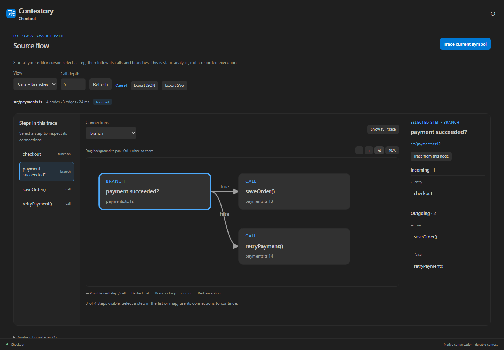

# Guias da interface

## Overview e Requests

1. Abra o Contextory e selecione o Project responsável. Overview mostra pedidos abertos, progresso das especificações e as três atividades mais recentes; um workspace vazio convida à criação de um pedido.
2. Abra Requests e selecione + New request. Preencha Title e What should change?, escolha os projetos afetados se necessário e selecione Create request.
3. Expanda um marco e selecione sua especificação. Inspecione Contract, Issues, Decisions, Evidence, Outcome, Usage e History. Search history também busca explicações dos registros descendentes.
4. Use Explore relationships para abrir registros e locais de código vinculados. Exporte um relatório quando precisar transferir o contexto.

Pedidos no Panel horizontal do editor.

Durante a troca de projeto, a interface mostra Switching project e ignora respostas do projeto anterior. Trocar de projeto limpa rascunhos de formulários. Durante uma operação, o indicador de progresso e o aviso de estado informam atividade ou falha.

## Inspecione arquitetura e fluxo de código

1. Abra Architecture ou execute Contextory: Explore Architecture. Selecione um subsistema, arquivo e símbolo no mapa, árvore e inspetor coordenados.
2. Use Explore connections e os filtros de relação/direção. As linhas de Matrix dependem das colunas; o marcador recíproco identifica dependências diretas nas duas direções.
3. Para fluxo detalhado, posicione o cursor em uma função e execute Contextory: Trace Flow from Here ou use Code map. Selecione uma etapa para inspecionar chamadas, desvios e código.
4. Use zoom, Fit, arraste o fundo e os botões de código. Se não houver conexões indexadas, escolha outro escopo ou Refresh code index e revise os avisos de cobertura.

Explorador Architecture capturado do Contextory.

Explorador de fluxo limitado do Contextory.

## Revise Knowledge e Versions

1. Abra Knowledge. Filtre entradas por categoria, texto ou caminho e inspecione a definição, testes e atualização.
2. Para uma linha de base observada ou alteração pendente, leia a proposta exata e informe um motivo antes de Approve baseline, Approve change ou Reject. Apenas uma pessoa usa esses controles de revisão.
3. Abra Versions para inspecionar a versão atual, commits e planos de release. Revise versão, arquivos e changelog antes de aplicar um plano. Publish é uma ação separada que exige autorização de release.

Versions capturado da aplicação.

[Entender revisão de definições e atualização das fontes](knowledge.md)

[Entender planos de release e publicação](releases.md)

## Histórico, layout e uso do teclado

1. Abra History ou Full history em Overview. Filtre por pedido, marco ou especificação e use Load older activity para consultar eventos anteriores.
2. Para usar o layout horizontal, mova Workspace Tasks para o Panel do editor e redimensione. Em áreas largas e baixas, a lista de pedidos aparece ao lado do inspetor da especificação.
3. Use Tab para alcançar controles, Enter ou Espaço para ativar nós dos mapas, setas nos diagramas com foco e Ctrl+roda para zoom. A interface acompanha o tema e as cores de alto contraste do editor.

Histórico do projeto no Panel do editor.

Redimensionar ou mudar a posição preserva seleção e rascunhos dentro do mesmo projeto. Estados inicial/carregando/erro/desabilitado dependem do projeto selecionado e do serviço disponível. As imagens publicadas são capturas reais existentes da aplicação, com registros de exemplo; não foram recapturadas em um chat nativo autenticado durante esta reescrita.

## Fontes

- src/webview/main.ts
- src/webview/architecture.ts
- src/webview/flow.ts
- src/webview/catalog.ts
- src/webview/versions.ts
- tests/ui/sidebar.spec.ts
- tests/ui/catalog.spec.ts

