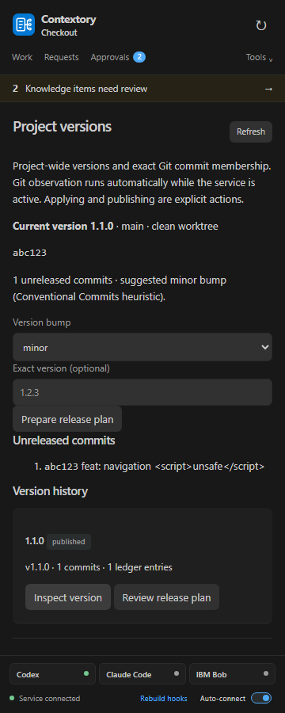
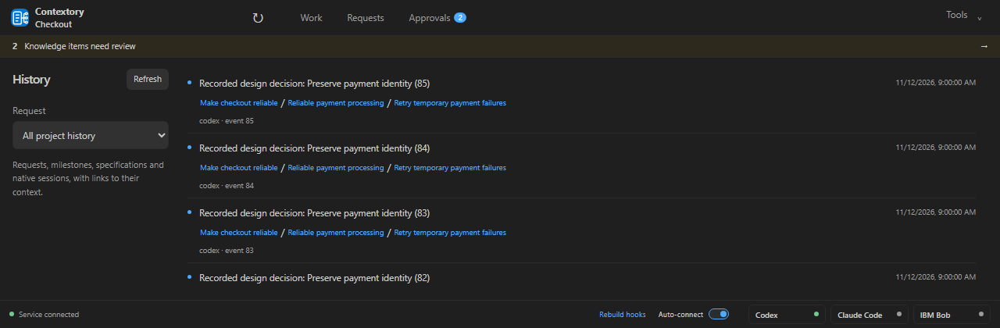

# Guias da interface

## Work e Requests

1. Abra o Contextory e selecione o Project responsável. Work mostra a especificação atual, evidências registradas por critério, verificações em execução, bloqueios e o último registro relevante. Um projeto vazio oferece um novo pedido.
2. Escolha Requests e + New request. Preencha Title e What should change?, selecione os projetos afetados quando necessário e use Create request. Abra um pedido para inspecionar seu plano; expanda o resumo e as ações quando precisar.
3. Expanda um marco, selecione sua especificação e abra Specification details para plano, problemas, decisões, evidências, resultado, uso ou histórico. As contagens descrevem verificações registradas; elas não estimam o tempo restante.
4. Use Tools para Knowledge, Versions, History, Code map e Architecture. Exportações e relações continuam disponíveis no pedido ou especificação selecionados.

Pedidos no Panel horizontal do editor.

Durante a troca de projeto, a interface mostra Switching project e ignora respostas do projeto anterior. Trocar de projeto limpa rascunhos de formulários. Durante uma operação, o indicador de progresso e o aviso de estado informam atividade ou falha.

## Inspecione arquitetura e fluxo de código

1. Abra Tools > Architecture ou execute Contextory: Explore Architecture. Selecione subsistema, arquivo e símbolo no mapa, árvore e inspetor coordenados.
2. Use Explore connections e os filtros de relação/direção. As linhas de Matrix dependem das colunas; o marcador recíproco identifica dependências diretas nas duas direções.
3. Para fluxo detalhado, posicione o cursor em uma função e execute Contextory: Trace Flow from Here ou use Code map. Selecione uma etapa para inspecionar chamadas, desvios e código.
4. Use zoom, Fit, arraste o fundo e os botões de código. Se não houver conexões indexadas, escolha outro escopo ou Refresh code index e revise os avisos de cobertura.

Explorador Architecture capturado do Contextory.

Explorador de fluxo limitado do Contextory.

## Use Approvals, Knowledge e Versions

1. Abra a aba Approvals ou o alerta para revisar pendências. A aba mostra um contador e não inclui definições já revisadas. Use Tools > Knowledge para buscar definições e consultar a cobertura das fontes.
2. Para uma linha de base observada ou alteração pendente, leia a proposta exata e informe um motivo antes de Approve baseline, Approve change ou Reject. Apenas uma pessoa usa esses controles de revisão.
3. Abra Tools > Versions para inspecionar versão, commits e planos de release. Revise versão, arquivos e changelog antes de aplicar; Publish é uma ação de release autorizada separadamente.

Versions capturado da aplicação.

[Entender revisão de definições e atualização das fontes](knowledge.md)

[Entender planos de release e publicação](releases.md)

## Histórico, layout e uso do teclado

1. Abra Tools > History ou o histórico do pedido/especificação selecionados. Filtre o escopo e use Load older activity para consultar eventos anteriores.
2. Para usar o layout horizontal, mova Workspace Tasks para o Panel do editor e redimensione. Em áreas largas e baixas, a lista de pedidos aparece ao lado do inspetor da especificação.
3. Use Tab para alcançar controles, Enter ou Espaço para ativar nós dos mapas, setas nos diagramas com foco e Ctrl+roda para zoom. A interface acompanha o tema e as cores de alto contraste do editor.

Histórico do projeto no Panel do editor.

Redimensionar ou mover preserva seleção, rascunhos, detalhes expandidos e rolagem no mesmo projeto. Barras laterais estreitas empilham trabalho e detalhes; painéis largos e baixos os separam. Carregamento, erros e dados da última atualização ficam explícitos. As capturas mostram a webview de produção com exemplos isolados, não um chat nativo autenticado.

## Fontes

- src/webview/main.ts
- src/webview/architecture.ts
- src/webview/flow.ts
- src/webview/catalog.ts
- src/webview/versions.ts
- tests/ui/sidebar.spec.ts
- tests/ui/catalog.spec.ts
- src/extension.ts
- src/service/reconnect.ts
- src/service/rpc.ts
- src/webview/progress.ts
- tests/ui/console.spec.ts
- tests/integration/recipe-configuration.test.ts
- scripts/verify-background-startup.mjs
- src/knowledge/catalog.ts
- tests/integration/catalog.test.ts

